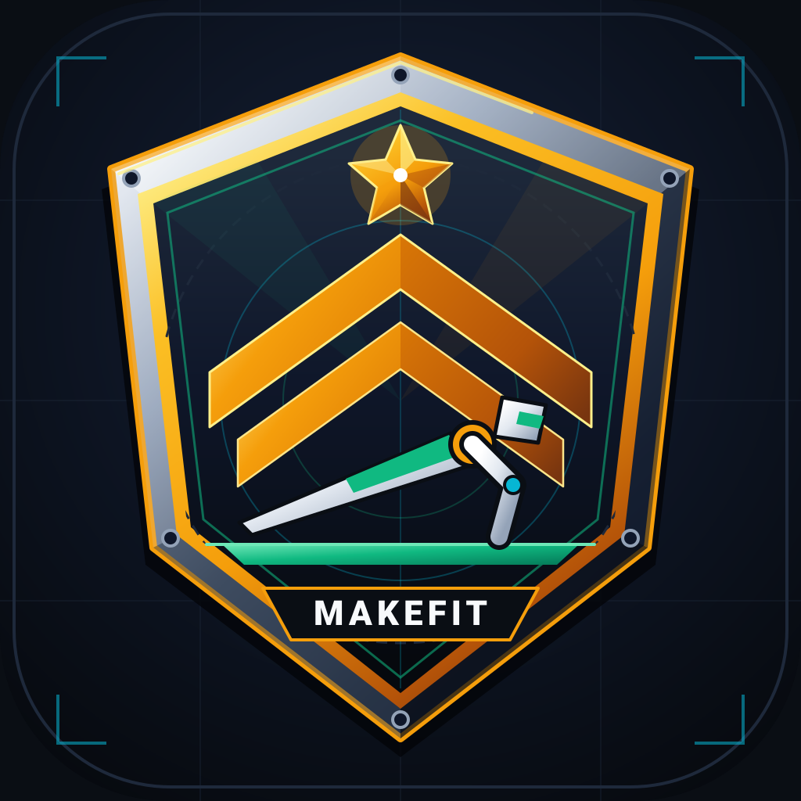
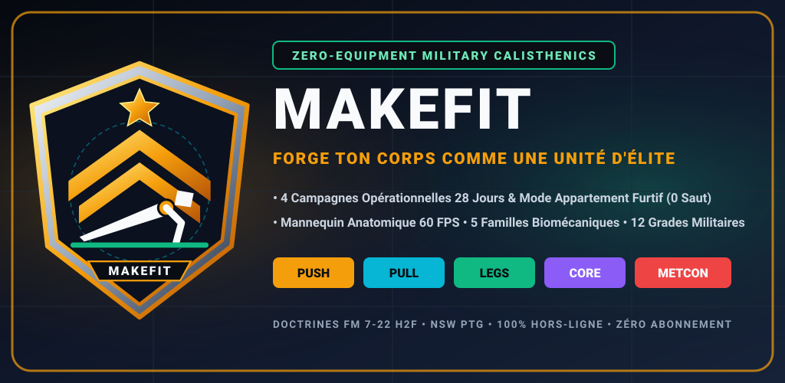
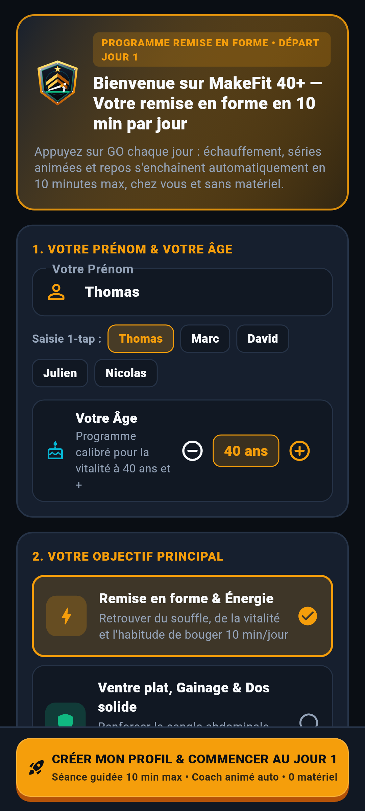
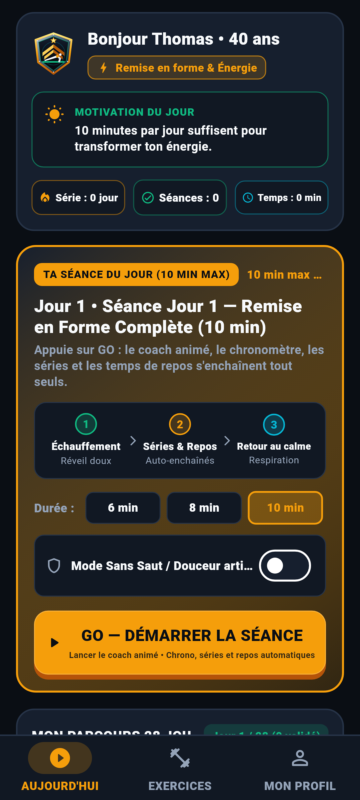
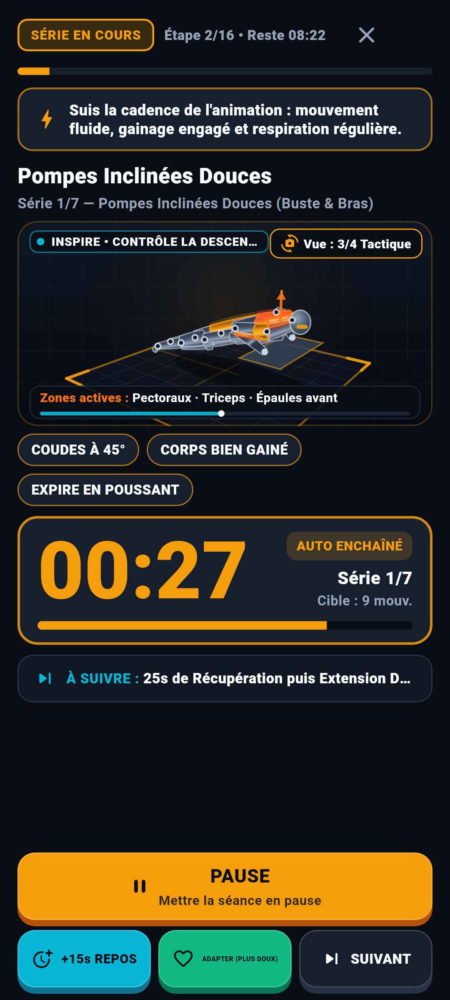
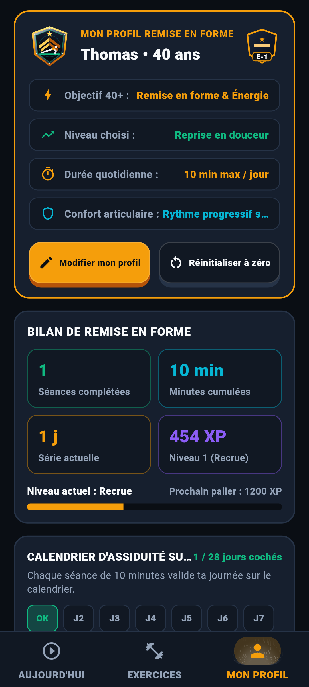

# MakeFit (`v1.1.0` — `cloud.orbital8.makefit`)

  

  

Application mobile native **Flutter Store-Ready (Android & iOS, moteur Impeller 60–120 FPS, Dart 3.x Sound Null Safety strict)** pensée pour la **Remise en Forme d'un Homme de 40 Ans avec des Séances Quotidiennes de 10 Minutes Maximum** (*Création de Profil au démarrage • Zéro Donnée d'Exemple • Bouton GO 100 % Automatique • Coach 3D/2.5D Animé en Continu • Motivation Quotidienne*).

- **Téléchargement APK & AAB Release `v1.1.0` :** [GitHub Releases (`v1.1.0`)](https://github.com/orbitalstorm/makefit/releases/tag/v1.1.0)

---

## 1. Nouveautés de la Refonte `v1.1.0` (`ORB-87`)

1. **Création du Profil au Démarrage & Zéro Donnée d'Exemple** :
   - Dès le premier lancement (`isProfileCreated == false`), l'application ouvre l'écran d'accueil **Création de Profil** (Prénom, Âge centré sur **40 ans**, Objectif principal, Niveau de départ, Durée quotidienne `6 min`, `8 min` ou `10 min max` et option *Ménager mes articulations / Sans saut*).
   - **Départ réel au Jour 1** : aucun chiffre pré-rempli (`Séances : 0`, `Temps : 0 min`, `Série : 0 jour`, `0 XP`).
2. **Séances Quotidiennes de 10 Minutes Maximum & Enchaînement 100 % Automatique au Bouton `GO`** :
   - Appuyez sur **`GO — DÉMARRER LA SÉANCE`** : l'échauffement articulaire, les séries chronométrées, les récupérations actives et le retour au calme **s'enchaînent automatiquement du début à la fin** sans avoir à toucher l'écran.
   - **Suppression totale** du comptage avec le nez/menton.
3. **Animations 60 FPS en Continu & Motivation en Temps Réel** :
   - Le coach 3D/2.5D s'anime en continu (`Timer` temps réel) pour accompagner chaque mouvement avec le bon rythme et afficher les zones travaillées.
   - Bannière de motivation dynamique, aperçu du prochain mouvement pendant la récupération et bilan motivant en fin de séance.

---

## 2. Captures d'Écran Store Portrait (`1080 × 2400`)

| Écran | Aperçu |
| :--- | :--- |
| **00. Création du Profil au Démarrage (40 ans, Objectif & Durée 10 min max)** |  |
| **01. Accueil Aujourd'hui (0 Donnée Démo, Motivation du Jour & Bouton GO 10 Min)** |  |
| **02. Lecteur de Séance Automatique, Coach Animé 60 FPS & Chrono Enchaîné** |  |
| **03. Retour au Calme & Anneau de Respiration Guidée (`4-4-4-4`)** |  |
| **04. Bilan de Fin de Séance Motivant, Ressenti 1–5 & Gain XP** |  |
| **05. Guide Visuel des Exercices Animés en Continu (Sans Matériel)** |  |
| **06. Mon Profil Remise en Forme 40+, Bilan & Calendrier d'Assiduité 28J** |  |

---

## 3. Les 5 Piliers Scientifiques & Techniques de MakeFit `v1.0.0`

1. **Programme Military Calisthenics 100 % Sans Matériel (`@Spartan` — ORB-82)** :
   - **Matrice `5 Familles × 5 Échelons` (25 exercices)** : Poussée (`PUSH`), Tirage au Sol & Scapula sans barre (`PULL` : *Prone Cobra*, *Prone I-Y-T-W*, *Supine Elbow Press / Floor Back Widow*, *Sliding Floor Pull-up*, *Thoracic Bridge*), Membres Inférieurs (`LEGS`), Gainage Tactique (`CORE`), et Cardio Métabolique (`METCON`).
   - **Ratio Postural `1:1` Push / Pull** surveillé en continu pour protéger la coiffe des rotateurs.
   - **Mode Silencieux Appartement (`0 saut`, `< 35 dB`)** et adaptations articulaires **Wrist/Knee-Friendly** en 1 clic.
2. **Gamification "Tactical RPG" & Boucle d'Adhérence (`@Athena` — ORB-83)** :
   - **12 Grades Militaires (`E-1 Recrue` à `SF-2 Légende Tactique`)** avec *XP Banking* et **4 Examens PT de Promotion** (6 minutes).
   - **4 Campagnes Opérationnelles de 28 Jours** (112 missions) + **5 Formats de Routines Simples** (*Flash PT 5 min*, *EMOM*, *AMRAP*, *Pyramide Tactique $N^2$*, *Tabata HIIT*).
   - **Streak Résilient à Double Bouclier** : validation à 100 % par la séance *Mobilité H2F 5 min* + **Jetons de Permission Tactique (*Dog Tags*)** gagnés toutes les 7 séances.
3. **Mannequin Anatomique 3D/2.5D Procédural à 60 FPS (`@Carbon` — ORB-85)** :
   - Rendu temps réel sous Impeller des **25 cinématiques d'exercices** avec illumination thermique (`#EF4444` / `#F59E0B`) des muscles primaires et secondaires, 3 angles de caméra (`3/4 Tactique`, `Profil`, `Face`), **0 Mo de vidéo lourde** et fonctionnement **100 % hors-ligne**.
4. **Ergonomie Terrain "Sweat-Proof & Distance-First 2m" + Game Juice (`@Miyamoto` — ORB-86)** :
   - Chiffres tabulaires géants (`FontFeature.tabularFigures()`) lisibles à `2 mètres` au sol sur fond OLED `#0A0E14`.
   - **Zone Géante Sans Contact (`112dp`)** au bas de l'écran avec filtre anti-rebond biomécanique (`Debounce = 650 ms`), **Audio Ducking `-12 dB`** respectant Spotify/Apple Music, **Échauffement RAMP (3 min)** et **Box Breathing H2F `4-4-4-4` (2 min)**.
5. **Conformité Store-Ready (Apple App Store & Google Play Store)** :
   - *Health & Safety Medical Disclaimer* (Guideline 1.4.1), accès immédiat **Zero-Sign-Up Offline-First** (Guideline 5.1.1), zéro publicité pendant l'entraînement.
