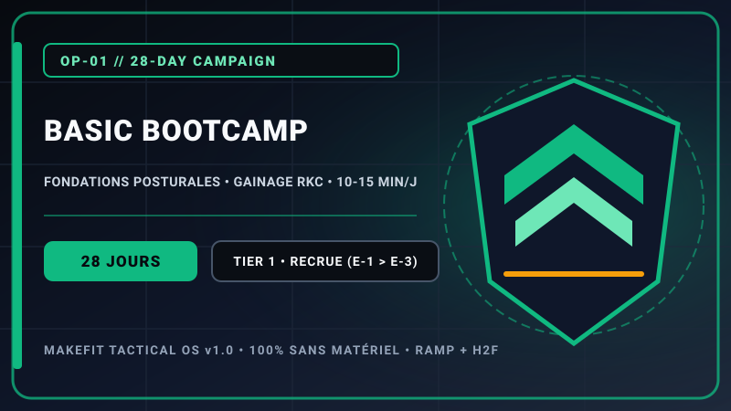
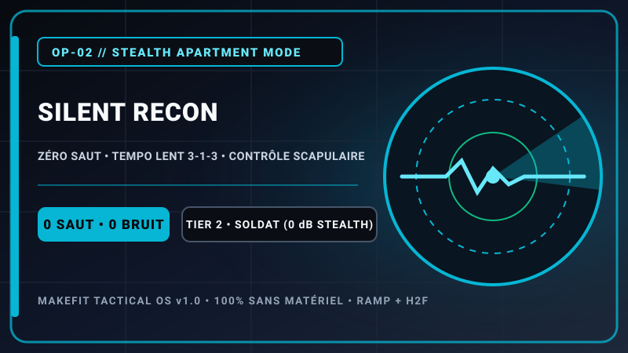
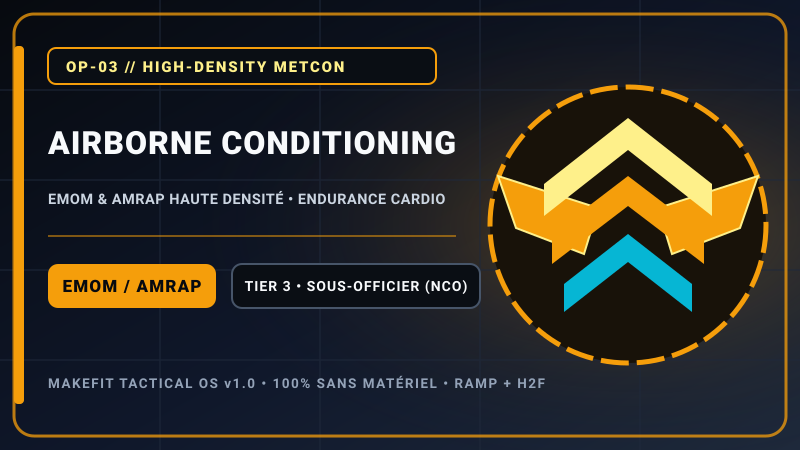
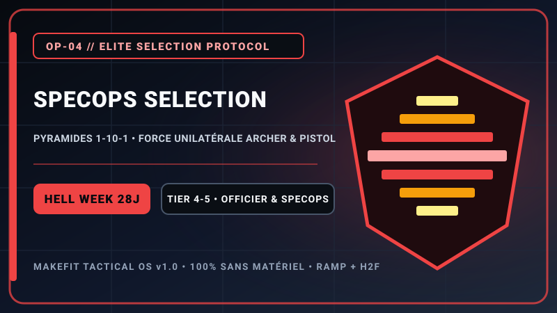
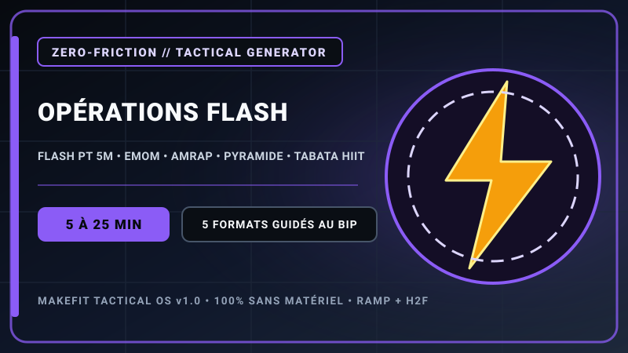
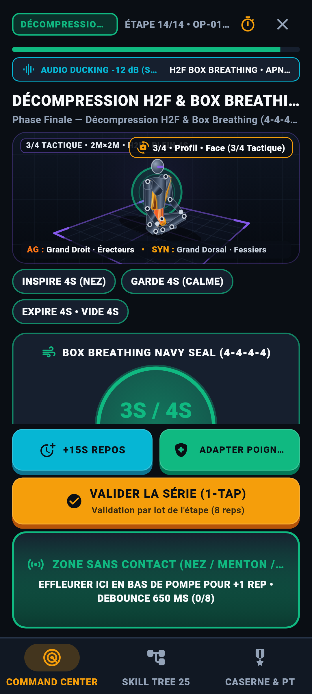
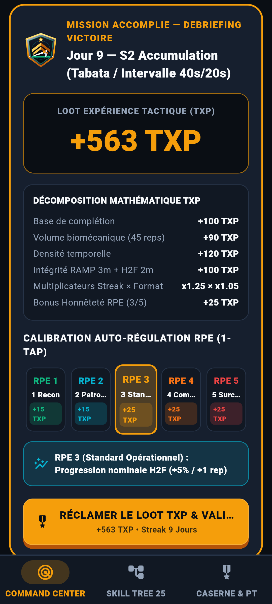
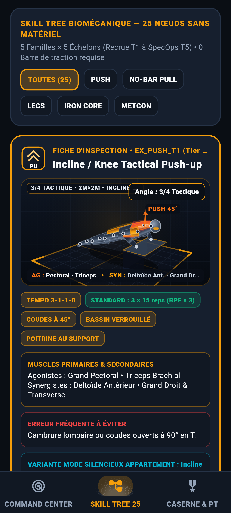

# MakeFit (`v1.0.0` — `cloud.orbital8.makefit`)

  

  

Application mobile native **Flutter Store-Ready & Gamifiée (Android & iOS, moteur Impeller 60–120 FPS, Dart 3.x Sound Null Safety strict)** dédiée au **Military Calisthenics 100 % Sans Matériel à Domicile** (*Bodyweight Training at Home, No Equipment Needed, Simple Routines, Tactical RPG*).

- **Téléchargement APK & AAB Release `v1.0.0` :** [GitHub Releases (`v1.0.0`)](https://github.com/orbitalstorm/makefit/releases/tag/v1.0.0)

---

## 1. Identité Visuelle, Logo Officiel & Miniatures des Campagnes (`@Leonardo` — ORB-84)

| Asset Store / Campagne | Aperçu |
| :--- | :--- |
| **Logo Officiel App Store / Google Play (`1024×1024`)** |  |
| **Bannière Feature Graphic Store (`1024×500`)** |  |
| **Opération 01 — Basic Bootcamp (28J • Fondations)** |  |
| **Opération 02 — Silent Recon (28J • Spécial Appartement 0 Saut)** |  |
| **Opération 03 — Airborne Conditioning (28J • EMOM / AMRAP)** |  |
| **Opération 04 — SpecOps Selection (28J • Pyramides 1→10→1)** |  |
| **Générateur de Routines Rapides (5 à 25 min)** |  |

---

## 2. Captures d'Écran Store Portrait (`1080 × 2400`)

| Écran | Aperçu |
| :--- | :--- |
| **01. Hub Command Center, Grade, Streak & Campagnes 28J** |  |
| **02. HUD Séance Lisible à 2m, Mannequin 3D/2.5D 60 FPS & Mode Sans Contact** |  |
| **03. Décompression H2F & Anneau Box Breathing Navy SEAL (`4-4-4-4`)** |  |
| **04. Modale Victoire, Calibration RPE 1-Tap & Loot TXP** |  |
| **05. Arbre de Compétences Biomécaniques (25 Exercices Sans Matériel)** |  |
| **06. La Caserne : 12 Grades Militaires, 4 Examens PT & Calibrateur IAO** |  |

---

## 3. Les 5 Piliers Scientifiques & Techniques de MakeFit `v1.0.0`

1. **Programme Military Calisthenics 100 % Sans Matériel (`@Spartan` — ORB-82)** :
   - **Matrice `5 Familles × 5 Échelons` (25 exercices)** : Poussée (`PUSH`), Tirage au Sol & Scapula sans barre (`PULL` : *Prone Cobra*, *Prone I-Y-T-W*, *Supine Elbow Press / Floor Back Widow*, *Sliding Floor Pull-up*, *Thoracic Bridge*), Membres Inférieurs (`LEGS`), Gainage Tactique (`CORE`), et Cardio Métabolique (`METCON`).
   - **Ratio Postural `1:1` Push / Pull** surveillé en continu pour protéger la coiffe des rotateurs.
   - **Mode Silencieux Appartement (`0 saut`, `< 35 dB`)** et adaptations articulaires **Wrist/Knee-Friendly** en 1 clic.
2. **Gamification "Tactical RPG" & Boucle d'Adhérence (`@Athena` — ORB-83)** :
   - **12 Grades Militaires (`E-1 Recrue` à `SF-2 Légende Tactique`)** avec *XP Banking* et **4 Examens PT de Promotion** (6 minutes).
   - **4 Campagnes Opérationnelles de 28 Jours** (112 missions) + **5 Formats de Routines Simples** (*Flash PT 5 min*, *EMOM*, *AMRAP*, *Pyramide Tactique $N^2$*, *Tabata HIIT*).
   - **Streak Résilient à Double Bouclier** : validation à 100 % par la séance *Mobilité H2F 5 min* + **Jetons de Permission Tactique (*Dog Tags*)** gagnés toutes les 7 séances.
3. **Mannequin Anatomique 3D/2.5D Procédural à 60 FPS (`@Carbon` — ORB-85)** :
   - Rendu temps réel sous Impeller des **25 cinématiques d'exercices** avec illumination thermique (`#EF4444` / `#F59E0B`) des muscles primaires et secondaires, 3 angles de caméra (`3/4 Tactique`, `Profil`, `Face`), **0 Mo de vidéo lourde** et fonctionnement **100 % hors-ligne**.
4. **Ergonomie Terrain "Sweat-Proof & Distance-First 2m" + Game Juice (`@Miyamoto` — ORB-86)** :
   - Chiffres tabulaires géants (`FontFeature.tabularFigures()`) lisibles à `2 mètres` au sol sur fond OLED `#0A0E14`.
   - **Zone Géante Sans Contact (`112dp`)** au bas de l'écran avec filtre anti-rebond biomécanique (`Debounce = 650 ms`), **Audio Ducking `-12 dB`** respectant Spotify/Apple Music, **Échauffement RAMP (3 min)** et **Box Breathing H2F `4-4-4-4` (2 min)**.
5. **Conformité Store-Ready (Apple App Store & Google Play Store)** :
   - *Health & Safety Medical Disclaimer* (Guideline 1.4.1), accès immédiat **Zero-Sign-Up Offline-First** (Guideline 5.1.1), zéro publicité pendant l'entraînement.
