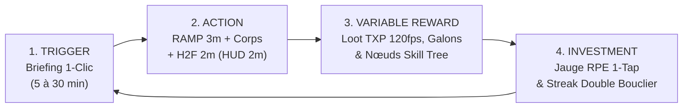

# MAKEFIT (`v1.0.0`) — Analyse Détaillée & Architecture Complète : Application Flutter Store-Ready & Gamifiée de Military Calisthenics (100 % Sans Équipement)

**Projet :** [MakeFit](/ORB/projects/makefit) (`cloud.orbital8.makefit`)  
**Issue source :** [ORB-81](/ORB/issues/ORB-81)  
**Architecte Principal :** [@Arnold](agent://108dc6c4-0b2a-4d1a-999f-dd040a8d6312) (*Lead System Architect & Release Manager*)  
**Spécialistes Programmation & Recherche Recrutés (Travaux Complétés ✅) :**
- **[@Spartan](agent://542e5fe3-eff4-4a5c-bec2-9567abff2eac)** (`/ORB/agents/spartan`) — *Docteur en Biomécanique & Spécialiste Préparation Physique Militaire (Zero-Equipment Calisthenics)* — Skill : `military-calisthenics-science` (`v1.0.0`) — **Livrable [ORB-82](/ORB/issues/ORB-82) :** `docs/research/MILITARY_CALISTHENICS_CURRICULUM.md`
- **[@Athena](agent://c172583c-c7b8-4491-a212-975ba7457980)** (`/ORB/agents/athena`) — *Spécialiste Sciences Comportementales, Gamification Sportive & Récupération Tactique (H2F)* — Skill : `tactical-fitness-gamification` (`v1.0.0`) — **Livrable [ORB-83](/ORB/issues/ORB-83) :** `docs/research/TACTICAL_GAMIFICATION_AND_HABITS.md`

**Spécialistes Ingénierie, UI/UX & Art Mobilisables pour le Build :**
- **[@Miyamoto](agent://71d2ab92-477f-4843-81fb-efc19256f34a)** (`/ORB/agents/miyamoto`) — *Architecte UI/UX Mobile Flutter & Game Juice* (`mobile-game-ui` `v1.2.0`)
- **[@Carbon](agent://889e5771-080d-41d1-a615-f56289907a9c)** (`/ORB/agents/carbon`) — *Ingénieur Moteur 3D/Mannequin Anatomique Impeller, Capteurs & Packaging Store-Ready* (`flutter-3d-blender-game` `v1.0.0`)
- **[@Leonardo](agent://ae568e0d-ac5a-4556-857b-3fe68c3f95ba)** (`/ORB/agents/leonardo`) — *Illustrateur Vectoriel Haute Précision (Insignes de grades `<svg>`, médailles & planches anatomiques `CustomPainter`)*

---

## 1. Synthèse Exécutive & Positionnement Produit

Le marché des applications de fitness à domicile souffre de trois défauts structurels majeurs :
1. **L'illusion du "Sans Équipement"** : La plupart des applications "Bodyweight" finissent par exiger une barre de traction, des anneaux ou des haltères dès la semaine 2, ou bien suppriment totalement le travail du dos, provoquant des douleurs d'épaule (conflit sous-acromial) par excès de pompes.
2. **La friction cognitive avant la séance** : Des menus complexes avec 500 vidéos disparates où l'utilisateur passe 10 minutes à choisir quoi faire avant d'abandonner.
3. **Une gamification superficielle ou punitive** : Des séries (*streaks*) qui se brisent au premier jour de repos ou de courbatures, décourageant 78 % des utilisateurs avant le jour 21.

**MakeFit (`Tactical Bodyweight Ops`)** résout ces trois problèmes à la racine :
* **100 % Zero-Equipment Strict (Espace `2m × 2m`)** : Aucune barre, aucun haltère, aucun élastique. Intégration de la biomécanique de tirage au sol (*Prone Cobra*, *Prone Scapular I-Y-T-W*, *Supine Elbow Press / Floor Back Widows*, *Prone Forearm Sliding Floor Pull-ups*, *Thoracic Bridge*) pour garantir un ratio d'équilibre postural $\mathcal{B}_{\text{postural}} \in [0.85, 1.15]$ entre Poussée et Tirage.
* **Routines Simples "Zero-Friction" (5, 10, 15, 20 ou 30 minutes)** : Formats opérationnels éprouvés (*Flash PT 5 min*, *EMOM*, *AMRAP*, *Pyramides Tactiques 1→N→1*, *Tabata HIIT*) jouables en **1 clic** depuis l'écran d'accueil, avec bascule instantanée **"Mode Silencieux Appartement" (*Stealth Mode : 0 saut, `< 35 dB`*)**.
* **Gamification "Tactical RPG" Résiliente** : Progression à travers **12 Grades Militaires** (`E-1 Recrue` à `SF-2 Légende Tactique`), **4 Examens PT de Promotion** (6 min), **4 Campagnes Scénarisées sur 28 Jours**, **Arbre de Compétences Biomécaniques (25 nœuds)** et **Streak à Double Bouclier** (séances de mobilité H2F 5 min validantes + *Jetons de Permission Tactique*).

---

## 2. Ingénierie Scientifique du Programme : Military Calisthenics Sans Équipement (`@Spartan` — [ORB-82](/ORB/issues/ORB-82))

> **Référentiel complet :** Voir `docs/research/MILITARY_CALISTHENICS_CURRICULUM.md` rédigé par **[@Spartan](agent://542e5fe3-eff4-4a5c-bec2-9567abff2eac)**.

### 2.1. Fondations Doctrinales Militaires Adaptées au Domicile
Le programme synthétise quatre doctrines officielles de préparation physique opérationnelle :
1. **US Army FM 7-22 (*Holistic Health and Fitness — H2F*)** : Préparation intégrée combinant échauffement standardisé (*Preparation Drill* RAMP 3 min), force fonctionnelle, gainage anti-rotation, endurance musculaire et récupération active (*Recovery Drill* H2F 2 min).
2. **US Navy SEAL (*Naval Special Warfare Physical Training Guide — NSW PTG*)** : Surcharge progressive au poids du corps, travail en densité temporelle et conditionnement mental par objectifs fractionnés (Pyramides `1→N→1`).
3. **USMC (*Physical Fitness Test / Combat Fitness Test*) & Légion Étrangère** : Cadence stricte commandée au métronome/bip sonore, endurance sous fatigue contrôlée.
4. **Biomécanique Calisthénique Moderne** : Gestion scientifique des 5 leviers d'intensité sans charge additionnelle (bras de levier momentané, transfert unilatéral, temps sous tension excentrique `3-1-1-0`, déficit d'amplitude, explosivité ou isométrie maximale en *Stealth Mode*).

### 2.2. Matrice Complète des 25 Exercices Sans Matériel (5 Familles × 5 Échelons)

Chaque exercice de l'application appartient à l'une des **5 familles fondamentales** et possède **5 échelons de difficulté**, accompagnés d'une variante **Mode Silencieux Appartement (`0 saut`)** et d'une variante **Wrist/Knee-Friendly** :

| Famille Biomécanique | Code | Échelon 1 — Recrue (*Débutant*) | Échelon 2 — Soldat (*Standard*) | Échelon 3 — Sous-Officier (*Intermédiaire*) | Échelon 4 — Officier (*Avancé*) | Échelon 5 — SpecOps (*Élite*) |
| :--- | :---: | :--- | :--- | :--- | :--- | :--- |
| **1. Poussée (*Upper Push*)** | `PUSH` | `EX_PUSH_T1`<br>**Incline / Knee Tactical Push-up** | `EX_PUSH_T2`<br>**Military Strict Push-up (45°)** | `EX_PUSH_T3`<br>**Diamond & Pike Push-up** | `EX_PUSH_T4`<br>**Archer & Pseudo-Planche Push-up** | `EX_PUSH_T5`<br>**Strict One-Arm / Wall Handstand Push-up** |
| **2. Chaîne Postérieure & Tirage Sans Barre (*No-Bar Pull*)** | `PULL` | `EX_PULL_T1`<br>**Prone Cobra Hold & Scapular Pinch** | `EX_PULL_T2`<br>**Prone I-Y-T-W Scapular Raises** | `EX_PULL_T3`<br>**Supine Elbow Press (*Floor Back Widow*)** | `EX_PULL_T4`<br>**Prone Forearm Sliding Floor Pull-up** | `EX_PULL_T5`<br>**Single-Arm Sliding Pull & Thoracic Bridge** |
| **3. Membres Inférieurs (*Tactical Legs*)** | `LEGS` | `EX_LEGS_T1`<br>**Assisted Tempo Squat & Glute Bridge** | `EX_LEGS_T2`<br>**Military Air Squat & Reverse Lunge** | `EX_LEGS_T3`<br>**Tempo Pause Squat (3-2-1) & 1-Leg Bridge** | `EX_LEGS_T4`<br>**Bulgarian Split, Cossack & Hamstring Walkout** | `EX_LEGS_T5`<br>**Strict Pistol Squat & Shrimp Squat** |
| **4. Gainage Tactique (*Iron Core*)** | `CORE` | `EX_CORE_T1`<br>**Dead Bug Strict & McGill Curl-up** | `EX_CORE_T2`<br>**RKC Plank & 4-Count Flutter Kicks** | `EX_CORE_T3`<br>**Hollow Body Hold & Plank Shoulder Taps** | `EX_CORE_T4`<br>**Hollow Body Rocks & Tactical V-Ups** | `EX_CORE_T5`<br>**Floor L-Sit Hold & Floor Dragon Flag** |
| **5. Cardio Métabolique (*MetCon*)** | `METCON` | `EX_METCON_T1`<br>**Step-Jacks & Squat-to-Reach** | `EX_METCON_T2`<br>**Jumping Jacks & Mountain Climbers** | `EX_METCON_T3`<br>**6-Count Military Burpee & Bear Crawl** | `EX_METCON_T4`<br>**8-Count Navy SEAL Bodybuilder** | `EX_METCON_T5`<br>**Devil Burpee (Double Push-up) & Speed Crawl** |

> **Mode Silencieux Appartement (*Stealth Mode*) :** Un interrupteur global sur l'écran de briefing remplace automatiquement tous les exercices pliométriques par des équivalents métaboliques haute intensité **100 % sans saut** (*No-Jump Step-Back Burpees*, *Slow Bear Crawl*, *Speed Step-Jacks*, *Prisoner Tempo Squats*, *Plank Walkouts*).

### 2.3. Les 5 Formats de Routines Simples ("Zero-Friction")

1. **Format "Flash PT" (`5 minutes` — Réveil Articulaire & Maintien du Streak)** :
   * `60s` Mobilisation RAMP + `4 minutes` de circuit continu (4 stations × `45s Effort / 15s Transition` : `PUSH` + `PULL` + `LEGS` + `CORE`). Valide 100 % du Streak quotidien les jours chargés.
2. **Format "EMOM Opérationnel" (`10, 15 ou 20 minutes`)** :
   * *Every Minute On the Minute* : `Minute Impaire (A)` = Poussée + Gainage (`35s–42s` d'effort cible) ; `Minute Paire (B)` = Tirage au sol + Jambes. Le reste de la minute constitue le repos mérité.
3. **Format "AMRAP Haute Densité" (`12 ou 18 minutes`)** :
   * *As Many Rounds As Possible* sur une boucle équilibrée de 4 stations (`PUSH` + `PULL` + `LEGS` + `CORE/METCON`). Score calculé au centième de tour : $\text{Score}_{\text{AMRAP}} = N_{\text{tours}} + \frac{\sum r_j}{\sum R_i}$.
4. **Format "Pyramide Tactique" (*Ladder `1 → N → 1`*, `15 à 25 minutes`)** :
   * Loi des multiplicateurs biomécaniques `1 : 2 : 3 : 4` (ex: `1×k Pull/MetCon`, `2×k Push`, `3×k Legs`, `4×k Core`). Le volume total d'une pyramide symétrique de sommet $N$ vaut exactement $V_{\text{total}}(m, N) = m \cdot N^2$ (de $N=5$ soit `25×m` reps en Tier 1 jusqu'à $N=10$ soit `100×m` reps en Tier 5).
5. **Format "Tabata / Intervalle Opérationnel" (`40s/20s` ou `20s/10s`, `12 à 20 minutes`)** :
   * Zéro comptage mental requis : exécution *Eyes-Free / Hands-Free* guidée par les bips d'Audio Ducking (`3-2-1-GO`) et les impulsions haptiques.

### 2.4. Calibration Initiale (Test PT 6 min) & Auto-Régulation Mathématique RPE

* **Test PT Initial (6 minutes)** :
  * `Bloc 1 (2 min)` : Max Push-ups ($R_{\text{push}}^{\text{eff}}$) $\rightarrow S_{\text{push}} = \min(100, \text{round}(100 \times (R_{\text{push}}^{\text{eff}}/60)^{0.85}))$.
  * `Bloc 2 (2 min)` : Max Air Squats ($R_{\text{squat}}$) $\rightarrow S_{\text{legs}} = \min(100, \text{round}(100 \times (R_{\text{squat}}/80)^{0.85}))$.
  * `Bloc 3 (2 min)` : Max RKC Plank ($T_{\text{plank}}$) $\rightarrow S_{\text{core}} = \min(100, \text{round}(100 \times (T_{\text{plank}}/120)^{0.90}))$.
  * **Indice d'Aptitude Opérationnelle** : $\text{IAO} = \text{round}(0.35 S_{\text{push}} + 0.35 S_{\text{legs}} + 0.30 S_{\text{core}}) \in [0, 100]$, attribuant automatiquement l'échelon $\text{Tier } 1 \dots 5$ par famille biomécanique.
* **Algorithme d'Auto-Régulation RPE (1-Tap Post-Workout)** :
  * $$R_{n+1} = \text{clamp}\Big(\text{round}\big(R_n \cdot (1 + \gamma(r_n, C_n)) + \delta(r_n, C_n)\big),\; R_{\min},\; R_{\max}\Big)$$
  * `RPE 1 (Recon)` : $+15\%$ volume (ou promotion $\text{Tier } k+1$ si confirmé).
  * `RPE 2 (Patrouille)` : $+10\%$ volume.
  * `RPE 3 (Standard Opérationnel)` : $+5\%$ volume ($+1$ à $+2$ reps/série) — zone cible optimale.
  * `RPE 4 (Combat Intense)` : Consolidation ($0\%$ hausse, $+5\text{s}$ repos inter-séries).
  * `RPE 5 (Surchauffe / Échec)` : *Tactical Deload* automatique ($-20\%$ volume, $+15\text{s}$ repos) + recommandation *Flash PT Mobilité H2F*.
* **Indice d'Équilibre Postural Push/Pull** :
  * $\mathcal{B}_{\text{postural}} = \frac{\sum_{7\text{j}} V_{\text{PULL}}}{\sum_{7\text{j}} V_{\text{PUSH}}}$. Si $\mathcal{B}_{\text{postural}} < 0.85$, injection automatique d'une série supplémentaire de rétraction scapulaire (`EX_PULL`) dès la séance suivante.

---

## 3. Gamification "Tactical RPG", Ergonomie 2m & Protocoles H2F (`@Athena` — [ORB-83](/ORB/issues/ORB-83))

> **Spécification complète :** Voir `docs/research/TACTICAL_GAMIFICATION_AND_HABITS.md` rédigée par **[@Athena](agent://c172583c-c7b8-4491-a212-975ba7457980)**.

### 3.1. Formule Déterministe des TXP & Barème des 12 Grades Militaires (`E-1` à `SF-2`)



$$\text{TXP}_{\text{total}} = \left\lfloor \left( \text{TXP}_{\text{base}} + \text{TXP}_{\text{volume}} + \text{TXP}_{\text{durée}} + \text{TXP}_{\text{RAMP\_H2F}} \right) \times M_{\text{streak}} \times M_{\text{format}} \right\rfloor + \text{TXP}_{\text{RPE}} + \text{TXP}_{\text{trial}}$$

* **Prime Santé Articulaire ($\text{TXP}_{\text{RAMP\_H2F}}$)** : `+35 TXP` (Échauffement RAMP 3 min) + `+35 TXP` (Décompression H2F 2 min) + `+30 TXP` (Combo Full Protocol) = **`+100 TXP`** garantissant que l'utilisateur ne saute ni l'échauffement ni le retour au calme.
* **Les 12 Grades Militaires & 4 Examens PT de Promotion (*XP Banking* sans perte)** :
  1. `E-1 Recrue` (`0 TXP`) — Calibration initiale 60s
  2. `E-2 Soldat` (`1 200 TXP`) — Déblocage Générateur *EMOM* & *Tabata*
  3. `E-3 Caporal` (`3 500 TXP` + **Examen PT #1 *Bootcamp Qualification***) — Déblocage Tier 2 Skill Tree
  4. `E-4 Sergent` (`7 000 TXP`) — 2e slot de *Jeton de Permission Tactique*
  5. `E-5 Sergent-Chef` (`12 000 TXP` + **Examen PT #2 *NCO Tactical Trial***) — Déblocage Tier 3 + *Opération 02 Silent Recon*
  6. `E-6 Adjudant` (`18 500 TXP`) — Thème HUD *"Night Vision Emerald"*
  7. `E-7 Major` (`27 000 TXP`) — Déblocage *Opération 03 Airborne Conditioning*
  8. `O-1 Lieutenant` (`38 000 TXP` + **Examen PT #3 *Officer Endurance Crucible***) — Déblocage Tier 4 Skill Tree
  9. `O-2 Capitaine` (`52 000 TXP`) — Constructeur de Missions Personnalisées
  10. `O-3 Commandant` (`70 000 TXP`) — Déblocage *Opération 04 SpecOps Selection*
  11. `SF-1 Opérateur` (`95 000 TXP` + **Examen PT #4 *SpecOps Hell Week Trial***) — Déblocage Tier 5 Élite (*Pistol*, *One-Arm Push-up*)
  12. `SF-2 Légende Tactique` (`130 000 TXP`) — Insigne Or/Carbone Animé + Mode Prestige Infini

### 3.2. Les 4 Campagnes Opérationnelles de 28 Jours & Streak à Double Bouclier
* **4 Campagnes Périodisées sur 4 Semaines** (*S1 Acclimatation → S2 Accumulation → S3 Intensification → S4 Affûtage & Boss Mission J28*) :
  1. **Opération 01 — *Basic Bootcamp* (`10–15 min/j`, Tiers 1–2, 100 % Gratuit)** : Fondations posturales, équilibre Push/Pull `1:1` et ancrage d'habitude.
  2. **Opération 02 — *Silent Recon* (`15 min/j`, Tiers 2–3, 100 % Appartement `0 saut`)** : Temps sous tension lent (`3-1-1-0` / `4-2-1-0`), isométrie haute densité et contrôle moteur silencieux.
  3. **Opération 03 — *Airborne Conditioning* (`20 min/j`, Tiers 2–4)** : Endurance cardiovasculaire et musculaire intense (*EMOM*, *AMRAP*, *Tabata*).
  4. **Opération 04 — *SpecOps Selection* (`25–30 min/j`, Tiers 3–5)** : Pyramides commando `1→10→1`, force unilatérale (*Archer*, *Pistol*, *Sliding Floor Pull*) et résilience mentale.
* **Système de Streak Résilient (Zéro Punition Injuste)** :
  * **Bouclier 1** : La séance **`Flash PT — Mobilité & Décompression H2F (5 min)`** valide à 100 % le Streak quotidien les jours de courbatures ou de fatigue.
  * **Bouclier 2** : Attribution automatique d'un **Jeton de Permission Tactique (*Tactical Leave Pass*, stock max `2/2` Dog Tags, surplus converti en `+250 TXP`)** toutes les 7 séances validées, protégeant automatiquement la série en cas de journée d'absence imprévue.

### 3.3. Ergonomie Spécifique en Séance : "Sweat-Proof, Floor-First & Eyes-Free"

| Contrainte Terrain | Solution Ergonomique & Technique Implémentée |
| :--- | :--- |
| **Téléphone posé au sol à 1,50 m – 2,00 m** | **HUD "Distance-First"** : Chrono et compteur en police tabulaire géante (`88pt–96pt Black`, `FontFeature.tabularFigures()`), contraste AAA (`18.5:1`) sur fond OLED `#0A0E14`, code couleur sémantique (Ambre `#F59E0B` = Effort, Cyan `#06B6D4` = Repos, Émeraude `#10B981` = Dernières 5s / Validation). |
| **Mains occupées au sol (Pompes / Gainage)** | **Double Mode Sans Contact** : Enchaînement automatique Work/Rest + **Zone Tactile Géante Inférieure (`height: 120dp`)** activable du bout du nez/menton/pouce + détection de proximité avec **filtre anti-rebond biomécanique (`Debounce = 650 ms`)** + bouton `VALIDER LA SÉRIE (1-TAP)`. |
| **Mains humides / Sueur** | **Touch Targets Surdimensionnés (`minHeight: 64dp`)** dans la *Thumb Zone* inférieure, espacés de `16dp`, avec feedback physique 3D *Squash & Stretch* (`0.94` en `75ms`). |
| **Écoute de musique personnelle (Spotify / Apple Music)** | **Audio Ducking Natif (`AudioCueService`)** : Configuration `AVAudioSessionCategoryOptions.mixWithOthers | duckOthers` (iOS) et `gainTransientMayDuck` (Android) abaissant Spotify de `-12 dB` pendant `300–1100 ms` lors des bips `3-2-1-GO`, puis restaurant `100 %` du volume via `abandonFocus()` immédiat. |
| **Prévention des blessures & Retour au calme** | **Protocole RAMP (`3 min` = 6×30s)** en pré-séance + **Décompression H2F & Box Breathing Navy SEAL (`4-4-4-4`, `2 min`)** en post-séance guidée par anneau lumineux et micro-vibrations haptiques. |

---

## 4. Architecture Technique Flutter Professionnelle (Android & iOS)

### 4.1. Stack Technique & Principes d'Ingénierie
* **SDK & Moteur de Rendu** : Flutter (Dart 3.x **Sound Null Safety strict** : `strict-casts: true`, `strict-inference: true`, `strict-raw-types: true`, zéro `dynamic`), optimisé pour le moteur **Impeller** (60–120 FPS constants sur iOS et Android, zéro *shader compilation jank*).
* **Architecture Applicative** : **Clean Architecture Feature-First** avec séparation stricte entre :
  1. `domain/` : Modèles immuables (`@immutable`), entités biomécaniques, moteur de règles de progression RPE (`AdaptiveProgressionEngine`), machine à états 60Hz (`WorkoutStateMachine`) et calculateur de TXP/Grades (`RankPromotionEvaluator`) — 100 % testables unitairement en Dart pur.
  2. `data/` : Stockage **100 % Offline-First** (persistance locale transactionnelle avec sauvegarde d'état de séance toutes les secondes pour permettre la reprise après appel téléphonique ou batterie faible).
  3. `presentation/` : Widgets déclaratifs `const`, `ValueNotifier` / `ValueListenableBuilder` ciblés et `CustomPainter` isolés par `RepaintBoundary`.

### 4.2. Arborescence Modulaire Cible (`lib/`)
```text
lib/
├── main.dart                                 # Bootstrap, SystemChrome portrait/immersive, Provider/Scope racine
├── src/
│   ├── core/
│   │   ├── theme/
│   │   │   ├── tactical_theme.dart           # Design System OLED (#0A0E14, Ambre #F59E0B, Emeraude #10B981)
│   │   │   └── tactical_typography.dart      # Typographie tabulaire HUD & hiérarchie visuelle
│   │   ├── services/
│   │   │   ├── audio_cue_service.dart        # Bips 3-2-1, TTS hors-ligne & Audio Ducking respectant Spotify
│   │   │   ├── haptic_tactical_service.dart  # Patterns Taptic Engine / Vibrator (tempo, fin de série, promotion)
│   │   │   ├── wakelock_service.dart         # Maintien écran allumé en séance
│   │   │   └── local_storage_service.dart    # Persistance Offline-First & crash-recovery de séance en cours
│   ├── domain/
│   │   ├── models/
│   │   │   ├── exercise_model.dart           # Exercice, famille biomécanique, échelon 1..5, muscles, mode silencieux
│   │   │   ├── routine_model.dart            # Formats EMOM, AMRAP, Pyramid, Tabata, Flash PT & blocs RAMP/H2F
│   │   │   ├── soldier_profile_model.dart    # Grade E-1..SF-2, TXP, Streak, Jetons Permission, records PT
│   │   │   └── workout_session_log.dart      # Journal de séance, RPE 1..5, volume par groupe musculaire
│   │   ├── engine/
│   │   │   ├── adaptive_progression_engine.dart # Algorithme d'adaptation automatique via RPE & ratio Push/Pull
│   │   │   ├── workout_state_machine.dart    # Machine à états finis (RAMP -> Work -> Rest -> Cooldown H2F)
│   │   │   └── rank_promotion_evaluator.dart # Calcul TXP déterministe, multiplicateurs de streak & Tests PT
│   ├── data/
│   │   ├── catalogs/
│   │   │   ├── military_exercises_catalog.dart  # Base complète des 25 exercices sans matériel (5 familles × 5 tiers)
│   │   │   └── tactical_campaigns_catalog.dart  # Les 4 Campagnes de 28 jours + générateur de routines rapides
│   ├── presentation/
│   │   ├── widgets/
│   │   │   ├── juice_3d_button.dart          # Bouton physique 3D Squash & Stretch + Haptique
│   │   │   ├── interpolated_txp_counter.dart # Compteur animé 60/120fps sous RepaintBoundary
│   │   │   ├── anatomical_mannequin_painter.dart # Rendu vectoriel/3D temps réel de l'exercice et des muscles actifs
│   │   │   └── military_rank_badge_painter.dart  # Insignes vectoriels haute précision des 12 grades & médailles
│   │   ├── screens/
│   │   │   ├── onboarding_calibration_screen.dart # Diagnostic 60s + Test PT 6m (IAO, Mode Appartement, Disclaimer)
│   │   │   ├── command_center_home_screen.dart    # Hub principal : Mission du Jour 1-clic, Streak, Grade, Routines Rapides
│   │   │   ├── workout_briefing_sheet.dart        # Aperçu de la séance, switch "Mode Silencieux", adaptation poignets/genoux
│   │   │   ├── workout_player_screen.dart         # HUD d'entraînement 2m, Chrono géant, Mannequin animé, Compteur tactile
│   │   │   ├── mission_debrief_screen.dart        # Célébration Victoire, Jauge RPE 1-Tap, Gain TXP, Promotion de Grade
│   │   │   ├── calisthenics_skill_tree_screen.dart # Arbre de compétences interactif des 25 nœuds biomécaniques
│   │   │   └── barracks_analytics_screen.dart     # Caserne : Heatmap de régularité, Radar Push/Pull, Salle des Médailles
```

---

## 5. Exigences "Store-Ready" (Apple App Store & Google Play Store)

1. **Conformité Médicale & Sécurité Santé (*Guideline 1.4.1 Physical Harm*)** :
   * *Health & Safety Disclaimer* explicite lors de l'onboarding et dans les paramètres.
   * Bouton d'adaptation immédiate en séance (**`ADAPTER / DOULEUR`**) basculant en 1 clic vers la variante *Wrist-Friendly* ou *Knee-Friendly* sans pénaliser le score ni le Streak.
2. **Respect de la Vie Privée & "Zero-Sign-Up Wall" (*Guideline 5.1.1*)** :
   * Accès immédiat en **Profil Local Offline-First** sans création de compte obligatoire, avec export JSON/CSV et suppression complète des données locales en 2 clics.
3. **Intégration Native Android & iOS (`cloud.orbital8.makefit`)** :
   * Android `compileSdk 35+` / `targetSdk 35+`, compatibilité pages mémoire `16 KB`, icônes adaptatives, permissions `WAKE_LOCK` et `VIBRATE`.
   * iOS `Info.plist` Portrait verrouillé en séance, `AVAudioSession` configurée en `mixWithOthers | duckOthers`, `ITSAppUsesNonExemptEncryption = false`.
4. **Monétisation Store-Ready ("Fair Tactical Freemium")** :
   * **Zéro publicité pendant l'entraînement** pour garantir une note Store `4.8★+`.
   * Tier Gratuit complet (*Opération 01 Basic Bootcamp 28J*, Générateur 5–15 min, Mode Silencieux, Grades & Streaks) + *SpecOps Pass* optionnel pour les campagnes avancées et l'analytique experte.

---

## 6. Enjeux Critiques, Risques Techniques & Mesures de Mitigation

| Risque Identifié | Cause Racine | Solution Architecturale ("Zéro Pansement") |
| :--- | :--- | :--- |
| **1. Dérive du Timer en Arrière-Plan** | Suspension de `Timer.periodic` par Doze / App Nap lors du verrouillage écran. | Calcul par différence d'horloge monotone/système (`DateTime.now().difference(_phaseStartTimestamp)`) via `WidgetsBindingObserver` + notification locale exacte de fin de repos. |
| **2. Surchauffe GPU & Batterie** | Reconstruction du `Scaffold` complet à 60 FPS pendant 20 minutes. | Isolation stricte du chronomètre et du mannequin dans des `RepaintBoundary` pilotés par `ValueListenableBuilder<WorkoutTick>`. |
| **3. Poids Excessif de l'App (> 150 Mo)** | Vidéos MP4 lourdes qui échouent hors-ligne. | **Mannequin Anatomique Vectoriel/3D Articulé (`CustomPainter` @ 60fps)** piloté par keyframes JSON légers (`< 50 Ko`), 100 % hors-ligne (`0 ms` de chargement) avec surbrillance thermique des muscles actifs. |
| **4. Blessures Tendineuses (Épaules / Poignets / Lombaires)** | Déséquilibre Poussée/Tirage et sit-ups traumatisants. | Ratio `1:1` Push / No-Bar Floor Pull surveillé par $\mathcal{B}_{\text{postural}}$, remplacement des sit-ups par le gainage RKC / Hollow Body / McGill, et variantes *Wrist/Knee-Friendly* sur les 25 exercices. |

---

## 7. Feuille de Route d'Implémentation Multi-Agents (`MakeFit v1.0.0`)

1. **Lot 1 — Recherche Scientifique, Biomécanique & Ingénierie Comportementale (TERMINÉ ✅)** :
   * **[@Spartan](agent://542e5fe3-eff4-4a5c-bec2-9567abff2eac)** ([ORB-82](/ORB/issues/ORB-82)) : `docs/research/MILITARY_CALISTHENICS_CURRICULUM.md` livré et validé (25 exercices sans matériel, 5 formats mathématiques, Test PT 6 min `IAO`, algorithme RPE et index postural $\mathcal{B}_{\text{postural}}$).
   * **[@Athena](agent://c172583c-c7b8-4491-a212-975ba7457980)** ([ORB-83](/ORB/issues/ORB-83)) : `docs/research/TACTICAL_GAMIFICATION_AND_HABITS.md` livré et validé (formule TXP, 12 Grades Militaires, 4 Examens PT, 4 Campagnes 28J jour par jour, Streak à double bouclier, HUD 2m, Audio Ducking `-12 dB` et protocoles RAMP/H2F).
2. **Lot 2 — Scaffolding Flutter Store-Ready, Modèles & Moteur d'Entraînement (`@Carbon`)** :
   * Initialisation `cloud.orbital8.makefit` (Android/iOS), modèles immuables (`lib/src/domain/`), catalogue complet (`lib/src/data/`), machine à états du `WorkoutPlayer` avec horloge résiliente au cycle de vie OS, moteur RPE et mannequin biomécanique articulé temps réel.
3. **Lot 3 — Assets Vectoriels Militaires & Planches Anatomiques (`@Leonardo`)** :
   * Création des insignes vectoriels `<svg>` et `CustomPainter` pour les 12 Grades Militaires, les Médailles d'Opération, les icônes des 5 voies biomécaniques et le schéma anatomique de chaleur musculaire.
4. **Lot 4 — Interface Mobile "Tactical RPG", HUD Séance 2m & Game Juice (`@Miyamoto`)** :
   * Implémentation de l'Onboarding/Calibration 60s, du Hub *Command Center*, du *Workout Player* (HUD géant lisible à 2m + Mode Sans Contact), de l'Écran de Debriefing à rebond `Curves.elasticOut`, de l'Arbre de Compétences et de la Caserne analytique.
5. **Lot 5 — Validation QA, Captures Store `1080×2400` & Release `v1.0.0` (`@Arnold`)** :
   * Exécution `flutter analyze` (0 issue), `flutter test` (100 % passés + captures d'écran Store), compilation APK & AppBundle Release et publication GitHub Release `v1.0.0`.
