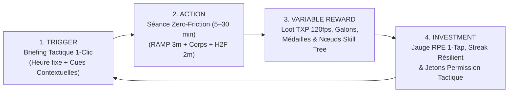
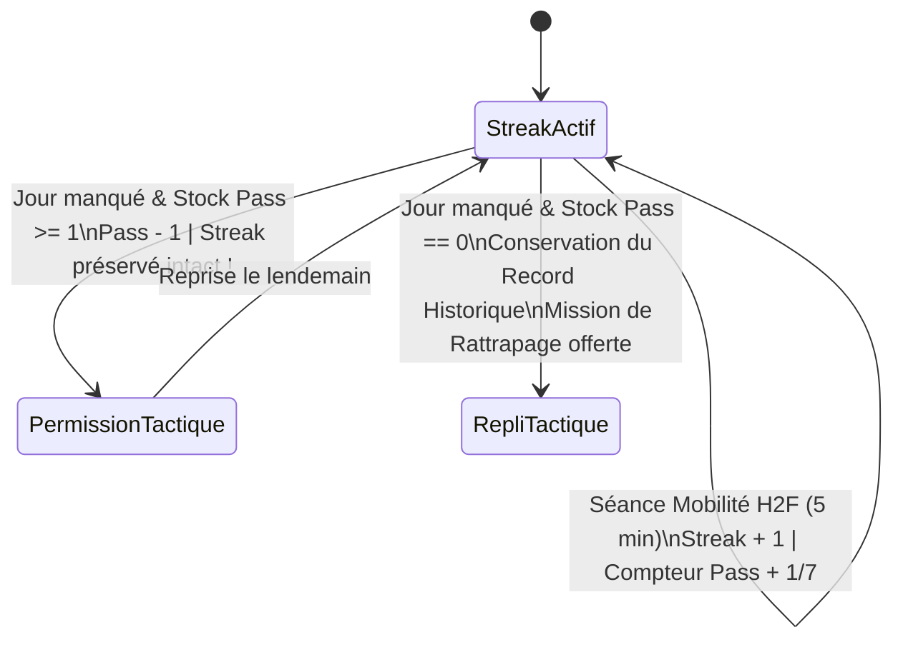

# MAKEFIT (`v1.0.0`) — Spécification Comportementale, Gamification "Tactical RPG", Ergonomie Sweat-Proof & Protocoles RAMP/H2F

**Projet :** [MakeFit](/ORB/projects/makefit) (`cloud.orbital8.makefit`)  
**Issue :** [ORB-83](/ORB/issues/ORB-83) (Parent : [ORB-81](/ORB/issues/ORB-81))  
**Auteure :** **[@Athena](agent://c172583c-c7b8-4491-a212-975ba7457980)** (*Spécialiste Sciences Comportementales, Gamification Sportive & Récupération Tactique H2F*)  
**Référentiel Skill :** `tactical-fitness-gamification` (`v1.0.0`)  
**Statut :** Spécification de Référence — Prête pour intégration `domain/` (`@Carbon`), `assets/` (`@Leonardo`) et `presentation/` (`@Miyamoto`)

---

## 1. Architecture Comportementale : Hook Model, Octalysis & Auto-Régulation RPE

### 1.1. Le Problème de l'Abandon dans le Fitness Mobile (Analyse D1 → D90)
Les études comportementales sur les applications de fitness au poids du corps révèlent trois points de rupture responsables de **78 % des abandons avant le Jour 21** :
1. **Paralysie décisionnelle à l'ouverture (*Pre-Workout Friction*)** : Trop de filtres, de vidéos et de choix tuent l'impulsion d'action.
2. **Effet "What-The-Hell" lié aux Streaks punitifs** : Lorsqu'un utilisateur perd une série de 14 jours à cause d'une journée de courbatures ou d'un déplacement professionnel, la démotivation induite par l'aversion à la perte (*Loss Aversion* mal calibrée) provoque l'arrêt définitif.
3. **Surentraînement ou ennui par absence d'auto-régulation** : Un programme rigide devient soit trop facile (ennui), soit trop taxant pour les tendons (abandon par douleur).

### 1.2. La Boucle d'Habitude Quotidienne MakeFit (*Tactical Hook Loop*)



| Phase du Hook Model | Levier Octalysis (Chou) | Implémentation Concrète dans MakeFit |
| :--- | :--- | :--- |
| **1. Trigger (Déclencheur)** | *CD1 : Epic Meaning & Calling* | Notification locale non culpabilisante (*"Briefing Opérationnel prêt : 12 min pour sécuriser le Jour 9 de Basic Bootcamp — Mode Silencieux disponible"*). Écran d'accueil **Command Center** avec un unique bouton primaire géant `DÉPLOYER LA MISSION DU JOUR`. |
| **2. Action (Exécution)** | *CD3 : Empowerment of Creativity & Feedback* | Démarrage en `< 2 secondes` sans mur d'inscription. Séance bornée (5 à 30 min), guidage audio/haptique sans les mains, bouton `ADAPTER L'EXERCICE` en 1 clic si douleur/fatigue. |
| **3. Variable Reward (Récompense)** | *CD2 : Development & Accomplishment* | Compteur de **TXP** animé à 120 FPS (`Curves.easeOutCubic`), progression visuelle sur la carte d'Opération 28J, déblocage de variantes biomécaniques dans le *Skill Tree* et Examens PT de Promotion. |
| **4. Investment (Investissement)** | *CD4 : Ownership & Possession* + *CD8 : Loss Avoidance bienveillante* | Saisie **RPE en 1 tap** qui personnalise instantanément la séance du lendemain + accumulation de **Jetons de Permission Tactique** (*Tactical Leave Pass*) tous les 7 jours. |

### 1.3. Algorithme d'Auto-Régulation RPE (1-Tap Post-Workout Calibration)
À l'écran `MissionDebriefScreen`, l'utilisateur sélectionne son **RPE Simplifié (1 à 5)** en un seul tap avant la validation finale des TXP. Ce score pilote le moteur `AdaptiveProgressionEngine` (`lib/src/domain/engine/adaptive_progression_engine.dart`) :

| Score RPE | Libellé Tactique | Ressenti Physiologique (RIR — *Reps In Reserve*) | Action Algorithmique sur `J+1` (`AdaptiveProgressionEngine`) | Bonus TXP Honnêteté |
| :---: | :--- | :--- | :--- | :---: |
| **RPE 1** | `RECON (Très Facile)` | `≥ 5 RIR` — Aucune fatigue musculaire ni essoufflement | Volume `+15 %` (arrondi au supérieur) **ET** proposition d'échelon supérieur (`Tier + 1`) sur la famille dominante | `+15 TXP` |
| **RPE 2** | `PATROUILLE (Facile)` | `3–4 RIR` — Exécution fluide, réserve confortable | Volume `+10 %` (ou `+2 reps/série` / `+5s` d'effort en Tabata) | `+15 TXP` |
| **RPE 3** | `STANDARD OPÉRATIONNEL (Optimal)` | `2 RIR` — Dernières répétitions intenses mais forme 100 % stricte | Progression nominale : `+1 rep/série` (ou maintien si record battu) — Zone cible d'hypertrophie/endurance | `+25 TXP` |
| **RPE 4** | `COMBAT INTENSE (Limite)` | `0–1 RIR` — Ralentissement concentrique net en fin de série | **Consolidation** : Maintien exact du quota sur les 2 prochaines séances de cette famille avant nouvelle hausse | `+25 TXP` |
| **RPE 5** | `SURCHAUFFE / ÉCHEC` | Échec musculaire ou dégradation posturale observée | **Tactical Deload Automatique** : Volume `-20 %` sur la séance suivante + suggestion d'une séance *Flash PT Mobilité 5 min* le lendemain | `+25 TXP` *(Zéro pénalité)* |

> **Principe psychologique fondamental :** Attribuer un bonus TXP identique (`+25 TXP`) à un `RPE 3`, `RPE 4` ou `RPE 5` élimine la triche de l'ego. L'utilisateur est récompensé pour sa lucidité opérationnelle et sa prévention des blessures.

---

## 2. Système de Progression "Tactical RPG" : 12 Grades, Formules TXP, 4 Examens PT & Skill Tree

### 2.1. Formules Mathématiques de Calcul des TXP (*Tactical Experience Points*)

Chaque séance validée calcule le gain total de **TXP** via une formule déterministe, pure et testable unitairement dans `RankPromotionEvaluator` :

$$\text{TXP}_{\text{total}} = \left\lfloor \left( \text{TXP}_{\text{base}} + \text{TXP}_{\text{volume}} + \text{TXP}_{\text{durée}} + \text{TXP}_{\text{RAMP\_H2F}} \right) \times M_{\text{streak}} \times M_{\text{format}} \right\rfloor + \text{TXP}_{\text{RPE}} + \text{TXP}_{\text{trial}}$$

Où chaque terme est défini exactement par :

1. **Base de Complétion ($\text{TXP}_{\text{base}}$)** :
   * Séance standard (10 à 30 min) : `100 TXP`
   * Séance courte *Flash PT / Mobilité Active* (5 min) : `60 TXP`
2. **Score de Volume Biomécanique ($\text{TXP}_{\text{volume}}$)** :
   * Exercices dynamiques : $\sum (\text{Reps validées} \times 2 \times C_{\text{tier}})$
   * Exercices isométriques (Gainage / Holds) : $\sum (\lfloor \text{Secondes tenues} / 5 \rfloor \times 2 \times C_{\text{tier}})$
   * Coefficient d'Échelon ($C_{\text{tier}}$) :
     * `Tier 1 (Recrue)` = `1.0`
     * `Tier 2 (Soldat)` = `1.2`
     * `Tier 3 (Sous-Officier)` = `1.5`
     * `Tier 4 (Officier)` = `1.8`
     * `Tier 5 (SpecOps)` = `2.2`
3. **Prime de Densité Temporelle ($\text{TXP}_{\text{durée}}$)** :
   * $+10 \text{ TXP}$ par minute complète d'effort effectif (`workMinutes * 10`).
4. **Prime d'Intégrité Articulaire ($\text{TXP}_{\text{RAMP\_H2F}}$)** :
   * Échauffement RAMP 3 min complété : `+35 TXP`
   * Décompression H2F & Box Breathing 2 min complétée : `+35 TXP`
   * *Combo Full Protocol (RAMP + Séance + H2F)* : `+30 TXP` supplémentaires (soit **`+100 TXP`** de bonus santé articulaire, incitant fortement à ne jamais sauter l'échauffement ni le retour au calme).
5. **Multiplicateur de Régularité ($M_{\text{streak}}$)** :
   * Jours 1 à 2 : `1.00`
   * Jours 3 à 6 : `1.10` (`+10 %`)
   * Jours 7 à 13 : `1.25` (`+25 %`)
   * Jours 14 à 27 : `1.40` (`+40 %`)
   * Jours 28+ (*Statut Vétéran*) : `1.50` (`+50 %` plafond)
6. **Multiplicateur de Format ($M_{\text{format}}$)** :
   * *Flash PT / Mobilité 5 min* : `1.00`
   * *Tabata / Intervalle* : `1.05`
   * *EMOM Opérationnel* : `1.10`
   * *AMRAP Haute Densité* : `1.15`
   * *Pyramide Tactique (1→N→1)* : `1.20`
7. **Bonus de Calibration RPE ($\text{TXP}_{\text{RPE}}$)** : `+15 TXP` (RPE 1–2) ou `+25 TXP` (RPE 3–5).
8. **Prime d'Examen PT ($\text{TXP}_{\text{trial}}$)** : `+500 TXP` à `+2 000 TXP` lors de la validation d'un *Promotion Trial*.

> **Exemple concret d'une séance typique (Jour 8 — EMOM 15 min, Échelon 2, RAMP + H2F inclus, Streak de 8 jours, RPE 3) :**
> * $\text{TXP}_{\text{base}} = 100$
> * $\text{TXP}_{\text{volume}} = (90 \text{ reps} \times 2 \times 1.2) = 216$
> * $\text{TXP}_{\text{durée}} = 15 \times 10 = 150$
> * $\text{TXP}_{\text{RAMP\_H2F}} = 35 + 35 + 30 = 100$
> * Sous-total $= 566 \text{ TXP}$
> * Application des multiplicateurs ($M_{\text{streak}} = 1.25$, $M_{\text{format}} = 1.10$) : $\lfloor 566 \times 1.25 \times 1.10 \rfloor = 778 \text{ TXP}$
> * Ajout $\text{TXP}_{\text{RPE}} (+25)$ : **Total = `803 TXP`**.

---

### 2.2. Barème Complet des 12 Grades Militaires (`E-1` à `SF-2`)

La progression s'étale sur **12 Grades Militaires** répartis en 4 Corps (*Enlisted*, *NCO*, *Officer*, *Special Forces*). Le franchissement des 4 grades charnières (`E-3`, `E-5`, `O-1`, `SF-1`) exige à la fois le quota de TXP cumulés **ET** la validation d'un **Examen PT de Promotion (*Promotion Trial*)** :

| Ordre | Code Grade | Titre Officiel | Corps | TXP Cumulés Requis | Delta TXP | Séances Estimées | Condition Spéciale / Examen PT | Récompense Débloquée |
| :---: | :---: | :--- | :--- | :---: | :---: | :---: | :--- | :--- |
| **01** | `E-1` | **Recrue** | Enrôlé (*Enlisted*) | `0 TXP` | — | Jour 1 | Calibration initiale 60s | Accès *Opération 01 Basic Bootcamp* + Badge `E-1` |
| **02** | `E-2` | **Soldat** | Enrôlé (*Enlisted*) | `1 200 TXP` | `+1 200` | ~2 séances | Compléter 1 séance avec RAMP + H2F | Déblocage Générateur *EMOM* & *Tabata* + Badge `E-2` |
| **03** | `E-3` | **Caporal** | Enrôlé (*Enlisted*) | `3 500 TXP` | `+2 300` | ~5 séances | **EXAMEN PT #1 : *Bootcamp Qualification*** | Déblocage Échelon 2 Skill Tree + Pyramides `1→5→1` |
| **04** | `E-4` | **Sergent** | Enrôlé (*Enlisted*) | `7 000 TXP` | `+3 500` | ~10 séances | Streak actif `≥ 5 jours` | Déblocage 2e slot de *Jeton Permission Tactique* |
| **05** | `E-5` | **Sergent-Chef** | Sous-Officier (*NCO*) | `12 000 TXP` | `+5 000` | ~16 séances | **EXAMEN PT #2 : *NCO Tactical Trial*** | Déblocage Échelon 3 Skill Tree + *Opération 02 Silent Recon* |
| **06** | `E-6` | **Adjudant** | Sous-Officier (*NCO*) | `18 500 TXP` | `+6 500` | ~24 séances | 1 Campagne ou 20 séances validées | Thème HUD *"Night Vision Emerald"* + Pyramides `1→8→1` |
| **07** | `E-7` | **Major** | Sous-Officier (*NCO*) | `27 000 TXP` | `+8 500` | ~34 séances | Ratio Push/Pull équilibré (`≥ 0.85`) sur 14j | Déblocage *Opération 03 Airborne Conditioning* |
| **08** | `O-1` | **Lieutenant** | Officier (*Officer*) | `38 000 TXP` | `+11 000` | ~46 séances | **EXAMEN PT #3 : *Officer Endurance Crucible*** | Déblocage Échelon 4 Skill Tree (*Archer*, *Bulgarian*) |
| **09** | `O-2` | **Capitaine** | Officier (*Officer*) | `52 000 TXP` | `+14 000` | ~62 séances | 50 séances cumulées sans blessure | Constructeur de Missions Personnalisées |
| **10** | `O-3` | **Commandant** | Officier (*Officer*) | `70 000 TXP` | `+18 000` | ~82 séances | 2 Campagnes de 28J complétées à 100 % | Accès *Opération 04 SpecOps Selection* + Pyramide `1→10→1` |
| **11** | `SF-1` | **Opérateur** | Forces Spéciales (*SpecOps*) | `95 000 TXP` | `+25 000` | ~110 séances | **EXAMEN PT #4 : *SpecOps Hell Week Trial*** | Déblocage Échelon 5 Skill Tree (*Pistol*, *One-Arm Push-up*) |
| **12** | `SF-2` | **Légende Tactique** | Forces Spéciales (*SpecOps*) | `130 000 TXP` | `+35 000` | ~150 séances | Les 4 Campagnes 28J validées + Tous nœuds Tier 4 | Insigne Or/Carbone Animé + Mode Prestige Infini |

> **Règle de Non-Blocage des TXP (*XP Banking*) :** Si un utilisateur atteint le seuil de TXP d'un grade à examen (ex: `3 500 TXP` pour `E-3 Caporal`) mais choisit de passer son Examen PT plus tard, **ses nouveaux TXP continuent de s'accumuler intégralement en réserve**. Dès l'examen réussi, son grade et sa barre de progression se mettent à jour instantanément avec le surplus accumulé.

---

### 2.3. Les 4 Examens PT de Promotion (*Promotion Trials* — Format Standardisé 6 Minutes)

Chaque Examen PT dure exactement **6 minutes d'effort (3 blocs de 2 minutes)** précédées de l'échauffement RAMP 3 min. L'utilisateur dispose d'un standard **Normal** (cible nominale), d'une variante **Mode Silencieux Appartement (0 saut)** et d'une variante **Joint-Friendly (Adaptation articulaire)** afin que personne ne soit bloqué par son environnement ou une sensibilité articulaire :

#### Examen PT #1 — Passage `E-3 Caporal` (*Bootcamp Qualification* — Prime : `+500 TXP`)
* **Bloc 1 (0:00 → 2:00) — Poussée & Tirage Postural** :
  * `15 Military Strict Push-ups` (ou `20 Incline/Knee Push-ups` en échelon adapté) + `15 Prone I-Y-T-W Raises` au sol.
* **Bloc 2 (2:00 → 4:00) — Membres Inférieurs** :
  * `30 Air Squats stricts` (bris de parallèle `90°`, extension complète des hanches en haut).
* **Bloc 3 (4:00 → 6:00) — Gainage & Cardio** :
  * `45 secondes RKC Plank` + `25 Jumping Jacks` (*Mode Silencieux : `25 Speed Step-Jacks + Squat-to-Reach`*).
* **Critère de réussite** : Compléter les quotas dans la fenêtre de 6 minutes avec `RPE ≤ 4`.

#### Examen PT #2 — Passage `E-5 Sergent-Chef` (*NCO Tactical Trial* — Prime : `+750 TXP`)
* **Bloc 1 (0:00 → 2:00) — Haut du Corps Complet** :
  * `25 Military Strict Push-ups` + `20 Prone Swimmers & Scapular Pulls`.
* **Bloc 2 (2:00 → 4:00) — Jambes & Explosivité Contrôlée** :
  * `40 Air Squats` + `20 Reverse Lunges alternés` (`10/jambe`).
* **Bloc 3 (4:00 → 6:00) — Gainage & MetCon** :
  * `45 secondes Hollow Body Hold` + `12 6-Count Military Burpees` (*Mode Silencieux : `12 No-Jump Step-Back Burpees` à tempo rapide*).
* **Critère de réussite** : Compléter les 3 blocs en moins de 6 minutes.

#### Examen PT #3 — Passage `O-1 Lieutenant` (*Officer Endurance Crucible* — Prime : `+1 200 TXP`)
* **Bloc 1 (0:00 → 2:00) — Force Poussée/Tirage Intermédiaire** :
  * `20 Diamond Push-ups` + `15 Pike Push-ups` + `20 Supine Elbow Presses (Floor Back Widows)`.
* **Bloc 2 (2:00 → 4:00) — Force Unilatérale Jambes** :
  * `15 Bulgarian Split Squats (Jambe Gauche)` + `15 Bulgarian Split Squats (Jambe Droite)` + `20 Tempo Pause Squats`.
* **Bloc 3 (4:00 → 6:00) — Core & Densité Commando** :
  * `60 secondes Hollow Body Hold / Rocks` + `18 8-Count Navy SEAL Bodybuilders` (*Mode Silencieux : `18 Stealth 8-Count Bodybuilders sans saut + 30s Bear Crawl`*).
* **Critère de réussite** : Compléter les 3 blocs dans les 6 minutes imparties.

#### Examen PT #4 — Passage `SF-1 Opérateur` (*SpecOps Hell Week Trial* — Prime : `+2 000 TXP`)
* **Bloc 1 (0:00 → 2:00) — Maîtrise Calisthénique Haut du Corps** :
  * `20 Archer Push-ups alternés` + `15 Pseudo-Planche Push-ups` + `20 Sliding Floor Pull-ups`.
* **Bloc 2 (2:00 → 4:00) — Maîtrise Unilatérale Bas du Corps** :
  * `8 Pistol Squats stricts Jambe Gauche` + `8 Pistol Squats stricts Jambe Droite` (*Adaptation Knee-Friendly : `20 Shrimp/Elevated Split Squats lents 4-1-1` par jambe*) + `20 Cossack Squats`.
* **Bloc 3 (4:00 → 6:00) — Conditionnement Extrême** :
  * `30 V-Ups / Floor L-Sit Tucks` + `22 Devil Burpees (Double Push-up)` (*Mode Silencieux : `22 Double-Push-up Stealth Burpees sans saut`*).
* **Critère de réussite** : Compléter l'intégralité du protocole sous la barre des 6:00.

---

### 2.4. Arbre de Compétences Biomécaniques (*Calisthenics Skill Tree* — 25 Nœuds)

L'écran `CalisthenicsSkillTreeScreen` affiche **5 Voies Biomécaniques × 5 Nœuds (Tiers 1 à 5)**. Un nœud `Tier N+1` se déverrouille dès que l'utilisateur valide le **Standard de Maîtrise** du nœud `Tier N` au cours de ses séances régulières (`RPE ≤ 3`) :

| Voie Biomécanique | Tier 1 (Recrue) | Tier 2 (Soldat) | Tier 3 (Sous-Officier) | Tier 4 (Officier) | Tier 5 (SpecOps) |
| :--- | :--- | :--- | :--- | :--- | :--- |
| **1. Push Mastery** | **Incline / Knee Push-up**<br>*Std : `3 × 15 reps`* | **Military Strict Push-up**<br>*Std : `3 × 20 reps`* | **Diamond & Pike Push-up**<br>*Std : `3 × 15 reps`* | **Archer & Pseudo-Planche**<br>*Std : `3 × 12 reps`* | **One-Arm & Wall HSPU**<br>*Std : `3 × 6 reps/côté`* |
| **2. No-Bar Pull & Scapula** | **Prone Cobra & Scap Retract**<br>*Std : `3 × 30s`* | **Prone I-Y-T-W Raises**<br>*Std : `3 × 16 reps`* | **Swimmers & Supine Elbow Press**<br>*Std : `3 × 15 reps`* | **Sliding Floor Pull-up**<br>*Std : `3 × 12 reps`* | **1-Arm Floor Pull & Thoracic Bridge**<br>*Std : `3 × 8 reps`* |
| **3. Tactical Legs** | **Assisted Squat & Glute Bridge**<br>*Std : `3 × 20 reps`* | **Air Squat & Reverse Lunge**<br>*Std : `3 × 25 reps`* | **Tempo Pause Squat & 1-Leg Bridge**<br>*Std : `3 × 15 reps`* | **Bulgarian Split & Cossack Squat**<br>*Std : `3 × 15 reps/jambe`* | **Pistol Squat & Nordic Eccentric**<br>*Std : `3 × 8 reps/jambe`* |
| **4. Iron Core** | **Dead Bug & Knee Plank**<br>*Std : `3 × 40s`* | **RKC Plank & Flutter Kicks**<br>*Std : `3 × 45s`* | **Hollow Body Hold & Side Plank**<br>*Std : `3 × 50s`* | **Hollow Rocks, V-Ups & Copenhagen**<br>*Std : `3 × 20 reps`* | **Floor L-Sit & Floor Dragon Flag**<br>*Std : `3 × 20s / 8 reps`* |
| **5. MetCon Engine** | **Step-Jacks & Squat-to-Reach**<br>*Std : `3 × 45s`* | **Jumping Jacks & Mountain Climbers**<br>*Std : `3 × 60s`* | **6-Count Military Burpees & Bear Crawl**<br>*Std : `15 reps / min`* | **8-Count SEAL Bodybuilders**<br>*Std : `15 reps / min`* | **Devil Burpees & Speed Bear Crawl**<br>*Std : `18 reps / min`* |

---

## 3. Découpage Jour par Jour des 4 Campagnes Opérationnelles de 28 Jours

Chaque campagne suit une **périodisation ondulatoire scientifique sur 4 semaines (Macrocycle de 28 jours)** :
* **Semaine 1 (Jours 1–7) — Phase d'Acclimatation & Technique** : Apprentissage moteur, tempo contrôlé, volume modéré.
* **Semaine 2 (Jours 8–14) — Phase d'Accumulation & Densité** : Augmentation du volume total (`+15 %`) et réduction progressive des temps de repos.
* **Semaine 3 (Jours 15–21) — Phase d'Intensification (*Overreaching Fonctionnel*)** : Introduction des Pyramides hautes et des AMRAP de référence.
* **Semaine 4 (Jours 22–28) — Phase d'Affûtage (*Taper*) & Épreuve Finale (*Boss Mission J28*)** : Assimilation nerveuse, surcompensation et validation de l'Opération au Jour 28.
* **Structure Hebdomadaire Respectueuse des Tendons** : 5 jours d'entraînement structuré + **2 jours de Récupération Active H2F / Flash PT Mobilité (Jours 4 et 7 de chaque semaine)** qui **valident à 100 % le Streak quotidien**.

---

### 3.1. Opération 01 — *Basic Bootcamp* (Fondations Posturales, Gainage & Habitude Quotidienne)
* **Public & Échelons Cibles** : Tous niveaux (Tiers 1 → 2) — **100 % Gratuit (Tier Standard)**.
* **Durée quotidienne** : `10 à 15 minutes` (incluant RAMP 3 min + Décompression H2F 2 min).
* **Objectif** : Installer une posture militaire irréprochable, équilibrer le ratio Poussée/Tirage au sol (`1:1`) et ancrer l'habitude de 28 jours sans courbatures invalidantes.

| Jour | Code Mission | Format | Durée | Contenu Opérationnel Détaillé (Corps de Séance hors RAMP 3m & H2F 2m) | Cible RPE |
| :---: | :--- | :--- | :---: | :--- | :---: |
| **J01** | `BB-01 : Induction Day` | **EMOM** | 12 min | **EMOM 7 min** : Min Impaire = `8 Incline/Knee Push-ups` + `8 Prone Cobra Scap Retractions` / Min Paire = `12 Air Squats` + `20s Dead Bug` | RPE 2–3 |
| **J02** | `BB-02 : Core & Posture` | **Tabata** | 12 min | **Tabata 7 min (`35s Work / 25s Rest` × 7)** : `1. Glute Bridge`, `2. Prone I-Y-T-W`, `3. Reverse Lunges`, `4. Knee/RKC Plank`, `5. Step-Jacks`, `6. Hand-Release Superman`, `7. Dead Bug` | RPE 2–3 |
| **J03** | `BB-03 : First Ladder` | **Pyramide** | 13 min | **Pyramide `1 → 4 → 1` (8 min)** : Par échelon $k \in \{1..4..1\}$ : $k \times 2$ `Push-ups adaptés`, $k \times 2$ `Prone I-Y-T-W`, $k \times 3$ `Air Squats`, $k \times 4$ `4-Count Flutter Kicks` | RPE 3 |
| **J04** | `BB-04 : Active Decompression` | **Flash PT H2F** | 5 min | **Mobilité & Déverrouillage Thoracique (5 min)** : `60s World's Greatest Stretch`, `60s Deep Squat Pry`, `60s Thoracic Bridge Reach`, `60s Child-to-Cobra Flow`, `60s Box Breathing 4-4-4-4` | RPE 1 |
| **J05** | `BB-05 : Benchmark Alpha` | **AMRAP** | 13 min | **AMRAP 8 min** : Boucle continue de `8 Push-ups`, `10 Prone I-Y-T-W`, `12 Air Squats`, `20s RKC Plank`. *(Enregistrement du score de référence Semaine 1)* | RPE 3 |
| **J06** | `BB-06 : MetCon Ignition` | **Intervalle** | 14 min | **3 Rounds (`40s Effort / 20s Repos` × 3 exos = 9 min)** : `1. Jumping Jacks (ou Step-Jacks)`, `2. Reverse Lunges alternés`, `3. Mountain Climbers contrôlés` | RPE 3 |
| **J07** | `BB-07 : Barracks Recovery` | **Flash PT H2F** | 5 min | **Récupération Parasympathique Fin de Semaine 1 (5 min)** : `90s Pigeon Stretch (45s/côté)`, `60s Supine Spinal Twist`, `60s Scapular Wall/Floor Slides`, `90s Box Breathing` *(+1 Jeton Permission Tactique gagné !)* | RPE 1 |
| **J08** | `BB-08 : Strict Standard` | **EMOM** | 15 min | **EMOM 10 min** : Min Impaire = `10 Military Push-ups (ou Incline)` + `10 Prone I-Y-T-W` / Min Paire = `15 Air Squats` + `25s RKC Plank` | RPE 3 |
| **J09** | `BB-09 : Posterior Armor` | **Tabata** | 13 min | **8 Rounds (`40s Work / 20s Rest`)** : Alternance `Supine Elbow Press (Back Widows)`, `Glute Bridge March`, `Prone Swimmers`, `Side Plank (G/D)` | RPE 3 |
| **J10** | `BB-10 : Tactical Hill` | **Pyramide** | 15 min | **Pyramide `1 → 5 → 1` (10 min)** : Par échelon $k$ : $k$ `Step-Back Burpees`, $k \times 2$ `Push-ups`, $k \times 2$ `Superman Pulls`, $k \times 3$ `Air Squats` | RPE 3–4 |
| **J11** | `BB-11 : Joint Care Ops` | **Flash PT H2F** | 5 min | **Mobilité Hanches, Chevilles & Poignets (5 min)** : `60s Wrist Flexor/Extensor Mobilization`, `60s 90/90 Hip Switches`, `60s Deep Squat Hold`, `120s Box Breathing` | RPE 1 |
| **J12** | `BB-12 : Benchmark Bravo` | **AMRAP** | 15 min | **AMRAP 10 min** : `10 Push-ups`, `12 Prone Swimmers`, `15 Air Squats`, `15 4-Count Flutter Kicks`. *(Objectif : dépasser la densité de J05)* | RPE 3–4 |
| **J13** | `BB-13 : Cadence Drill` | **EMOM** | 15 min | **EMOM 10 min** : Min 1 = `12 Reverse Lunges + 10 Squat Jumps/Pulses` / Min 2 = `10 Push-ups + 20s Plank Shoulder Taps` (5 tours) | RPE 3 |
| **J14** | `BB-14 : Mid-Campaign Reset` | **Flash PT H2F** | 5 min | **Décompression Mi-Campagne (5 min)** : `60s Cat-Cow + Thoracic Rotation`, `60s Couch/Quad Stretch`, `60s Cobra Hold`, `120s Box Breathing` *(+1 Jeton Permission Tactique)* | RPE 1 |
| **J15** | `BB-15 : Density Surge` | **EMOM** | 15 min | **EMOM 10 min** : Min Impaire = `12 Military Push-ups` + `12 Supine Elbow Presses` / Min Paire = `18 Air Squats` + `30s Hollow Body Tuck Hold` | RPE 3–4 |
| **J16** | `BB-16 : Fireteam Intervals` | **Tabata** | 15 min | **10 Rounds (`40s Work / 20s Rest`)** : `1. 6-Count Burpees (ou Stealth)`, `2. Prone I-Y-T-W`, `3. Tempo Squats (3-1-1)`, `4. RKC Plank`, `5. Mountain Climbers` (×2) | RPE 4 |
| **J17** | `BB-17 : Summit 6` | **Pyramide** | 15 min | **Pyramide `1 → 6 → 1` (10 min)** : Par échelon $k$ : $k \times 2$ `Push-ups`, $k \times 2$ `Prone Swimmers`, $k \times 3$ `Squats`, $k \times 3$ `Flutter Kicks` | RPE 4 |
| **J18** | `BB-18 : Tactical Mobility` | **Flash PT H2F** | 5 min | **Ouverture Scapulaire & Psoas (5 min)** : `60s Kneeling Psoas Lunge (G/D)`, `60s Prone Scorpion Reach`, `60s Downward Dog Pedal`, `120s Box Breathing` | RPE 1 |
| **J19** | `BB-19 : Benchmark Charlie` | **AMRAP** | 15 min | **AMRAP 10 min** : `10 Military Push-ups`, `12 Supine Elbow Presses`, `16 Reverse Lunges`, `10 6-Count Burpees (ou Step-Back)` | RPE 4 |
| **J20** | `BB-20 : Iron Core Ops` | **EMOM** | 15 min | **EMOM 10 min** : Min Impaire = `35s RKC Plank` + `12 Prone Cobra Pulls` / Min Paire = `20 Flutter Kicks` + `15 Glute Bridges` | RPE 3 |
| **J21** | `BB-21 : Pre-Taper Recovery` | **Flash PT H2F** | 5 min | **Décompression Nerveuse Semaine 3 (5 min)** : `90s Child's Pose Lat Stretch`, `90s Hamstring & Calf Floss`, `120s Box Breathing` *(+1 Jeton Permission Tactique)* | RPE 1 |
| **J22** | `BB-22 : Precision Tempo` | **EMOM** | 13 min | **EMOM 8 min (Tempo `3-1-1-0`)** : Min Impaire = `8 Tempo Push-ups` + `8 Tempo Swimmers` / Min Paire = `10 Tempo Pause Squats` | RPE 3 |
| **J23** | `BB-23 : Sharp Intervals` | **Tabata** | 13 min | **8 Rounds (`30s Work / 30s Rest` — Affûtage)** : `Push-ups`, `Prone I-Y-T-W`, `Air Squats rapides`, `Hollow Hold` (×2) | RPE 2–3 |
| **J24** | `BB-24 : Fast Pyramid` | **Pyramide** | 13 min | **Pyramide Rapide `1 → 5 → 1` (8 min)** : Exécution fluide et explosive avec `RIR ≥ 2` | RPE 3 |
| **J25** | `BB-25 : Joint Priming` | **Flash PT H2F** | 5 min | **Activation Articulaire Pré-Qualification (5 min)** : Mobilité complète + respiration parasympathique | RPE 1 |
| **J26** | `BB-26 : Final Rehearsal` | **EMOM** | 11 min | **EMOM 6 min léger** : 50 % du volume de l'épreuve finale pour activer le système nerveux sans fatigue résiduelle | RPE 2 |
| **J27** | `BB-27 : Eve of Deployment` | **Flash PT H2F** | 5 min | **Décompression Totale Veille d'Épreuve (5 min)** : Étirements doux + `3 min Box Breathing 4-4-4-4` | RPE 1 |
| **J28** | `BB-28 : BOSS MISSION — Bootcamp Graduation` | **AMRAP + Trial** | 15 min | **Épreuve Finale (10 min)** : `50 Push-ups cumulés` + `50 Prone I-Y-T-W` + `100 Air Squats` + `2 min RKC Plank cumulées` + `25 Burpees`. *(Débloque la Médaille "Basic Bootcamp Graduate" + `+1 000 TXP`)* | RPE 4 |

---

### 3.2. Opération 02 — *Silent Recon* (Spécial Appartement Zéro Saut, Contrôle Excentrique & Isométrie)
* **Public & Échelons Cibles** : Grades `E-3+` / Utilisateurs en appartement avec voisins sensibles ou cherchant un renforcement tendineux profond (Tiers 2 → 3).
* **Contrainte Acoustique Garantie** : **0 saut, 0 impact au sol (`< 35 dB`)**. Toute l'intensité provient des tempos lents (`3-2-1-0`, `4-2-1-0`), des pauses isométriques à mi-course et du travail en quadrupédie (*Bear Crawl*, *Plank Walkouts*).
* **Durée quotidienne** : `15 minutes` (10 min corps de séance + 3 min RAMP silencieux + 2 min H2F).

| Jour | Code Mission | Format | Durée | Contenu Opérationnel Détaillé (`100 % Zéro Impact / Zéro Saut`) | Cible RPE |
| :---: | :--- | :--- | :---: | :--- | :---: |
| **J01** | `SR-01 : Ghost Insertion` | **EMOM** | 15 min | **EMOM 10 min (Tempo `3-1-1`)** : Min Impaire = `10 Tempo Military Push-ups` + `10 Prone I-Y-T-W (2s hold)` / Min Paire = `12 Tempo Pause Squats (2s en bas)` | RPE 3 |
| **J02** | `SR-02 : Isometric Shield` | **Tabata** | 15 min | **10 Rounds (`40s Work / 20s Rest`)** : `1. RKC Plank`, `2. Wall/Air Squat Iso Hold 90°`, `3. Prone Cobra Iso Hold`, `4. Hollow Body Hold`, `5. Slow Bear Crawl (sur place 2m)` (×2) | RPE 3 |
| **J03** | `SR-03 : Silent Ladder` | **Pyramide** | 15 min | **Pyramide `1 → 5 → 1` (10 min)** : $k$ `No-Jump Step-Back Burpees`, $k \times 2$ `Diamond/Military Push-ups`, $k \times 2$ `Supine Elbow Presses`, $k \times 3$ `Reverse Lunges lents` | RPE 3 |
| **J04** | `SR-04 : Stealth Mobility` | **Flash PT H2F** | 5 min | **Mobilité Silencieuse & Décompression Lombaire (5 min)** : `90/90 Hip Flow`, `Thoracic Openers`, `Box Breathing` | RPE 1 |
| **J05** | `SR-05 : Recon AMRAP I` | **AMRAP** | 15 min | **AMRAP 10 min** : `8 Pike Push-ups`, `10 Prone Swimmers lents`, `12 Cossack / Side Lunges`, `6 Plank Walkouts (Inchworms)` | RPE 3–4 |
| **J06** | `SR-06 : Time Under Tension` | **EMOM** | 15 min | **EMOM 10 min (Tempo `4-2-1-0`)** : Min Impaire = `7 Ultra-Slow Push-ups` + `10 Scapular Retractions` / Min Paire = `8 Ultra-Slow Split Squats (4/jambe)` | RPE 3–4 |
| **J07** | `SR-07 : Recon Recovery I` | **Flash PT H2F** | 5 min | **Récupération Active H2F (5 min)** + *Jeton Permission Tactique* | RPE 1 |
| **J08** | `SR-08 : Quadruped Stalker` | **Tabata** | 15 min | **10 Rounds (`40s / 20s`)** : `1. Hover Bear Crawl Hold (genoux à 2 cm du sol)`, `2. Sliding Floor Pulls / Elbow Press`, `3. Single-Leg Glute Bridge (G/D)`, `4. Plank Shoulder Taps (zéro rotation bassin)`, `5. Speed Prisoner Squats` (×2) | RPE 3–4 |
| **J09** | `SR-09 : Eccentric Armor` | **EMOM** | 15 min | **EMOM 10 min** : Min Impaire = `10 Dive-Bomber / Hindu Push-ups` / Min Paire = `12 Tempo Bulgarian/Split Squats (6/jambe)` + `10 Prone Y-T-W` | RPE 4 |
| **J10** | `SR-10 : Silent Pyramid 6` | **Pyramide** | 15 min | **Pyramide `1 → 6 → 1` (10 min)** : $k$ `Stealth 8-Count Bodybuilders (step-back)`, $k \times 2$ `Push-ups`, $k \times 2$ `Supine Elbow Presses`, $k \times 2$ `Hollow Body Rocks` | RPE 4 |
| **J11** | `SR-11 : Wrist & Shoulder Care` | **Flash PT H2F** | 5 min | **Décompression Poignets, Coiffe des Rotateurs & Nuque (5 min)** | RPE 1 |
| **J12** | `SR-12 : Recon AMRAP II` | **AMRAP** | 15 min | **AMRAP 10 min** : `10 Diamond Push-ups`, `12 Supine Elbow Presses`, `14 Reverse Lunges + Pause`, `30s Hollow Body Hold`. *(Battre le nombre de tours de J05)* | RPE 4 |
| **J13** | `SR-13 : Pause-Rep Mastery` | **EMOM** | 15 min | **EMOM 10 min** : Chaque répétition inclut une **pause de 2 secondes au point de tension maximale** (bas de la pompe, haut du tirage dos, bas du squat) | RPE 3–4 |
| **J14** | `SR-14 : Recon Recovery II` | **Flash PT H2F** | 5 min | **Décompression Mi-Opération (5 min)** + *Jeton Permission Tactique* | RPE 1 |
| **J15** | `SR-15 : Shadow Density` | **EMOM** | 15 min | **EMOM 10 min** : Min Impaire = `12 Push-ups + 10s Iso Hold mi-course` / Min Paire = `15 Air Squats + 15s Iso Hold 90°` + `10 Prone Swimmers` | RPE 4 |
| **J16** | `SR-16 : Core Lockdown` | **Tabata** | 15 min | **10 Rounds (`45s Work / 15s Rest`)** : `RKC Plank`, `Side Plank Gauche`, `Side Plank Droit`, `Hollow Hold`, `Prone Superman Hold` (×2) | RPE 4 |
| **J17** | `SR-17 : Silent Summit 7` | **Pyramide** | 15 min | **Pyramide `1 → 7 → 1` (10 min)** : $k \times 2$ `Push-ups`, $k \times 2$ `Prone I-Y-T-W`, $k \times 3$ `Prisoner Squats`, $k \times 2$ `No-Jump Burpees` | RPE 4 |
| **J18** | `SR-18 : Hip & Spine Flow` | **Flash PT H2F** | 5 min | **Mobilité Profonde Chaîne Postérieure (5 min)** | RPE 1 |
| **J19** | `SR-19 : Recon AMRAP III` | **AMRAP** | 15 min | **AMRAP 10 min** : `10 Pike Push-ups`, `12 Sliding Floor Pulls / Back Widows`, `16 Cossack Squats`, `10 Stealth Burpees` | RPE 4 |
| **J20** | `SR-20 : Mechanical Drop-Set` | **EMOM** | 15 min | **EMOM 10 min** : Enchaînement sans pause `5 Diamond Push-ups + 5 Military Push-ups + 5 Incline Push-ups` (Min Impaire) / `8 Split Squats G + 8 Split Squats D + 10 Prone Swimmers` (Min Paire) | RPE 4 |
| **J21** | `SR-21 : Recon Recovery III` | **Flash PT H2F** | 5 min | **Décompression Nerveuse Semaine 3 (5 min)** + *Jeton Permission Tactique* | RPE 1 |
| **J22** | `SR-22 : Taper Control` | **EMOM** | 15 min | **EMOM 10 min (Volume `-20 %`, exécution chirurgicale `4-1-1`)** | RPE 2–3 |
| **J23** | `SR-23 : Tactical Breath & Iso` | **Tabata** | 13 min | **8 Rounds (`30s Work / 30s Rest`)** : Isométrie multi-angles sans fatigue résiduelle | RPE 2–3 |
| **J24** | `SR-24 : Smooth Ladder` | **Pyramide** | 13 min | **Pyramide `1 → 5 → 1` (8 min)** : Fluide, silencieuse, contrôle respiratoire nasal | RPE 3 |
| **J25** | `SR-25 : Joint Preparation` | **Flash PT H2F** | 5 min | **Mobilité Pré-Infiltration (5 min)** | RPE 1 |
| **J26** | `SR-26 : Recon Activation` | **EMOM** | 11 min | **EMOM 6 min d'activation neuromusculaire** | RPE 2 |
| **J27** | `SR-27 : Silence Before Storm` | **Flash PT H2F** | 5 min | **Box Breathing & Étirements Parasympathiques (5 min)** | RPE 1 |
| **J28** | `SR-28 : BOSS MISSION — Ghost Operator` | **AMRAP + Iso** | 15 min | **Épreuve Finale 100 % Silencieuse (10 min)** : `60 Strict Tempo Push-ups` + `60 Supine Elbow Presses` + `80 Tempo Pause Squats` + `90s RKC Plank` + `90s Squat Iso Hold 90°` (`0 bruit`). *(Médaille "Silent Recon Ghost" + `+1 250 TXP`)* | RPE 4 |

---

### 3.3. Opération 03 — *Airborne Conditioning* (Haute Densité Métabolique EMOM / AMRAP & Endurance Cardio)
* **Public & Échelons Cibles** : Grades `E-5+` / Athlètes cherchant un conditionnement cardiovasculaire militaire intense et une fonte adipeuse maximale (Tiers 3 → 4).
* **Durée quotidienne** : `20 minutes` (15 min corps de séance haute densité + 3 min RAMP + 2 min H2F).
* **Adaptation Appartement** : Compatible à 100 % avec le switch *Stealth Mode* (remplacement instantané des Burpees sautés par des *Speed Step-Back Burpees* et *Bear Crawls*).

| Jour | Code Mission | Format | Durée | Contenu Opérationnel Détaillé (Corps de Séance 15 min) | Cible RPE |
| :---: | :--- | :--- | :---: | :--- | :---: |
| **J01** | `AC-01 : Drop Zone Alpha` | **EMOM** | 20 min | **EMOM 15 min (3 blocs × 5 tours)** : Min 1 = `12 6-Count Burpees` / Min 2 = `15 Military Push-ups` + `15 Prone Swimmers` / Min 3 = `20 Air Squats` + `20 Mountain Climbers` | RPE 3–4 |
| **J02** | `AC-02 : Paratrooper Tabata` | **Tabata** | 20 min | **3 Tabatas de 4 min (`20s Sprint / 10s Rest` × 8, `1 min repos` entre blocs)** : Bloc 1 = `Burpees / Prone I-Y-T-W`, Bloc 2 = `Jump/Speed Squats / Push-ups`, Bloc 3 = `Mountain Climbers / Hollow Hold` | RPE 4 |
| **J03** | `AC-03 : Airborne Pyramid 7` | **Pyramide** | 20 min | **Pyramide `1 → 7 → 1` (15 min)** : $k$ `6-Count Burpees`, $k \times 2$ `Push-ups`, $k \times 2$ `Supine Elbow Presses`, $k \times 3$ `Air Squats` | RPE 3–4 |
| **J04** | `AC-04 : Flight Line Mobility` | **Flash PT H2F** | 5 min | **Décompression Chevilles, Mollets, Hanches & Épaules (5 min)** | RPE 1 |
| **J05** | `AC-05 : 15-Min Grinder I` | **AMRAP** | 20 min | **AMRAP 15 min** : `10 6-Count Burpees`, `15 Military Push-ups`, `15 Prone Swimmers`, `20 Alternating Lunges`, `20 Flutter Kicks (4-count)` | RPE 4 |
| **J06** | `AC-06 : Combat Intervals` | **Intervalle** | 20 min | **15 Rounds (`45s Effort / 15s Repos`)** : Rotation sur les 5 familles biomécaniques (`Diamond Push-ups`, `Back Widows`, `Jump/Tempo Lunges`, `V-Ups/Tucks`, `8-Count Bodybuilders`) × 3 tours | RPE 4 |
| **J07** | `AC-07 : Hangar Recovery I` | **Flash PT H2F** | 5 min | **Récupération Parasympathique H2F (5 min)** + *Jeton Permission Tactique* | RPE 1 |
| **J08** | `AC-08 : Death by EMOM` | **EMOM** | 20 min | **EMOM Progressif 15 min** : Min 1–5 = `10 Push-ups + 15 Squats` / Min 6–10 = `12 Push-ups + 18 Squats` / Min 11–15 = `14 Push-ups + 20 Squats` (+ `10 Prone Pulls` toutes les 3 min) | RPE 4 |
| **J09** | `AC-09 : Afterburner HIIT` | **Tabata** | 20 min | **15 Rounds (`40s Work / 20s Rest`)** : Haute cadence contrôlée avec bip métronome | RPE 4 |
| **J10** | `AC-10 : Airborne Pyramid 8` | **Pyramide** | 20 min | **Pyramide `1 → 8 → 1` (15 min)** : Sommet à `8 Burpees, 16 Push-ups, 16 Back Widows, 24 Squats` puis redescente rapide | RPE 4 |
| **J11** | `AC-11 : Thoracic & Hip Reset` | **Flash PT H2F** | 5 min | **Mobilité Articulaire Active (5 min)** | RPE 1 |
| **J12** | `AC-12 : 15-Min Grinder II` | **AMRAP** | 20 min | **AMRAP 15 min** : Même protocole que J05 — Objectif : `+1 à +2 tours complets` | RPE 4 |
| **J13** | `AC-13 : Redline Cadence` | **EMOM** | 20 min | **EMOM 15 min** : Alternance `8-Count SEAL Bodybuilders`, `Hindu Push-ups + Sliding Floor Pulls`, `Bulgarian Split Squats + Hollow Rocks` | RPE 4 |
| **J14** | `AC-14 : Hangar Recovery II` | **Flash PT H2F** | 5 min | **Décompression Mi-Campagne (5 min)** + *Jeton Permission Tactique* | RPE 1 |
| **J15** | `AC-15 : Shock Trooper EMOM` | **EMOM** | 20 min | **EMOM 15 min (Fenêtres de travail de 50s / 10s transition)** | RPE 4 |
| **J16** | `AC-16 : Hurricane Tabata` | **Tabata** | 20 min | **4 Blocs Tabata haute vélocité** avec ratio `1:1` Push/Pull garanti | RPE 4–5 |
| **J17** | `AC-17 : Airborne Pyramid 9` | **Pyramide** | 20 min | **Pyramide `1 → 9 → 1` (15 min)** : Volume total massif (`81 répétitions unitaires × facteur`) | RPE 4–5 |
| **J18** | `AC-18 : Tendon Deload Flow` | **Flash PT H2F** | 5 min | **Décompression Tendineuse Achille / Rotule / Épaule (5 min)** | RPE 1 |
| **J19** | `AC-19 : 15-Min Grinder III` | **AMRAP** | 20 min | **AMRAP 15 min de Pic (Semaine 3)** : Record personnel de densité | RPE 4–5 |
| **J20** | `AC-20 : Core & Engine Fusion` | **EMOM** | 20 min | **EMOM 15 min** : Combinaison gainage dynamique (`V-Ups`, `Hollow Rocks`) et cardio (`Bear Crawl`, `Burpees`) | RPE 4 |
| **J21** | `AC-21 : Hangar Recovery III` | **Flash PT H2F** | 5 min | **Récupération Profonde Semaine 3 (5 min)** + *Jeton Permission Tactique* | RPE 1 |
| **J22** | `AC-22 : Taper Velocity` | **EMOM** | 17 min | **EMOM 12 min** : Vitesse d'exécution maximale mais volume réduit de `-25 %` | RPE 3 |
| **J23** | `AC-23 : Alactic Intervals` | **Tabata** | 15 min | **10 Rounds (`20s Explosif / 40s Repos complet`)** : Fraîcheur nerveuse maximale | RPE 2–3 |
| **J24** | `AC-24 : Fast Ladder 6` | **Pyramide** | 15 min | **Pyramide `1 → 6 → 1` (10 min)** : Rythme de croisière maîtrise | RPE 3 |
| **J25** | `AC-25 : Mobility Check` | **Flash PT H2F** | 5 min | **Mobilité Complète Pré-Saut (5 min)** | RPE 1 |
| **J26** | `AC-26 : Jump Master Primer` | **EMOM** | 13 min | **EMOM 8 min d'activation cardio-musculaire** | RPE 2 |
| **J27** | `AC-27 : Pre-Drop Calm` | **Flash PT H2F** | 5 min | **Box Breathing 4-4-4-4 & Relâchement (5 min)** | RPE 1 |
| **J28** | `AC-28 : BOSS MISSION — Airborne Wings Test` | **Chipper 15m** | 20 min | **Épreuve Finale "300 Airborne" (Cap 15 min)** : `50 6-Count Burpees` + `75 Push-ups` + `50 Supine Elbow Presses / Floor Pulls` + `75 Air Squats` + `50 4-Count Flutter Kicks` (= **300 reps**). *(Médaille "Airborne Wings" + `+1 500 TXP`)* | RPE 4–5 |

---

### 3.4. Opération 04 — *SpecOps Selection* (Force Calisthénique Avancée, Unilatéral & Résilience Mentale)
* **Public & Échelons Cibles** : Grades `O-2+` / Athlètes avancés visant la maîtrise des mouvements d'élite sans matériel (*Archer/One-Arm Push-up*, *Pistol Squat*, *Sliding Floor Pull-up*, *L-Sit*, *Pyramide `1→10→1`*) — Tiers 4 → 5.
* **Durée quotidienne** : `25 à 30 minutes` (20–25 min corps de séance + 3 min RAMP + 2 min H2F).

| Jour | Code Mission | Format | Durée | Contenu Opérationnel Détaillé (Corps de Séance 20–25 min) | Cible RPE |
| :---: | :--- | :--- | :---: | :--- | :---: |
| **J01** | `SO-01 : Selection Day 1` | **EMOM** | 25 min | **EMOM 20 min** : Min 1 = `10 Archer Push-ups` + `10 Sliding Floor Pulls` / Min 2 = `10 Bulgarian Split Squats (G)` + `10 (D)` / Min 3 = `15 V-Ups` / Min 4 = `12 8-Count SEAL Bodybuilders` (5 tours) | RPE 4 |
| **J02** | `SO-02 : Unilateral Force` | **EMOM** | 25 min | **EMOM 20 min Force Pure** : Travail sur *Pistol Squats (ou progressions assistées/box)*, *Pseudo-Planche Push-ups*, *Single-Arm Floor Pull progressions* et *Copenhagen Plank* | RPE 4 |
| **J03** | `SO-03 : Commando Ladder 8` | **Pyramide** | 25 min | **Pyramide `1 → 8 → 1` (20 min)** : $k$ `8-Count Bodybuilders`, $k \times 2$ `Diamond/Archer Push-ups`, $k \times 2$ `Sliding Floor Pulls`, $k \times 2$ `Bulgarian/Pistol Squats` | RPE 4 |
| **J04** | `SO-04 : SpecOps Mobility I` | **Flash PT H2F** | 5 min | **Décompression Articulaire Haute Intensité (Poignets, Hanches, Épaules — 5 min)** | RPE 1 |
| **J05** | `SO-05 : Operator AMRAP 20` | **AMRAP** | 25 min | **AMRAP 20 min** : `8 Archer Push-ups`, `8 Pike/Wall HSPU`, `12 Sliding Floor Pulls`, `12 Pistol/Shrimp Squats alternés`, `10 Devil Burpees` | RPE 4 |
| **J06** | `SO-06 : Seals Crucible HIIT` | **Tabata** | 25 min | **20 Rounds (`45s Work / 15s Rest`)** : Enchaînement mental et physique sous fatigue contrôlée | RPE 4 |
| **J07** | `SO-07 : Basecamp Recovery I` | **Flash PT H2F** | 5 min | **Récupération Parasympathique H2F (5 min)** + *Jeton Permission Tactique* | RPE 1 |
| **J08** | `SO-08 : Leverage Mastery` | **EMOM** | 25 min | **EMOM 20 min** : Focus levier avancé (*One-Arm Push-up progressions*, *Floor L-Sit Holds*, *Thoracic Bridge*, *Nordic Hamstring Eccentrics*) | RPE 4 |
| **J09** | `SO-09 : Combat Density 20` | **Intervalle** | 25 min | **4 Blocs de 5 min (`50s Work / 10s Rest`)** | RPE 4 |
| **J10** | `SO-10 : Commando Ladder 9` | **Pyramide** | 27 min | **Pyramide `1 → 9 → 1` (22 min)** : Approche du sommet mythique `1→10→1` | RPE 4–5 |
| **J11** | `SO-11 : SpecOps Mobility II` | **Flash PT H2F** | 5 min | **Mobilité Active & Décompression Nerveuse (5 min)** | RPE 1 |
| **J12** | `SO-12 : Operator AMRAP II` | **AMRAP** | 25 min | **AMRAP 20 min** : Battre le score de référence de J05 | RPE 4–5 |
| **J13** | `SO-13 : Hell Week Prelude` | **EMOM** | 25 min | **EMOM 20 min** : Double densité Poussée/Tirage + Unilatéral Jambes | RPE 4 |
| **J14** | `SO-14 : Basecamp Recovery II` | **Flash PT H2F** | 5 min | **Décompression Mi-Sélection (5 min)** + *Jeton Permission Tactique* | RPE 1 |
| **J15** | `SO-15 : Peak Force EMOM` | **EMOM** | 28 min | **EMOM 23 min** : Volume maximal de la Semaine 3 d'intensification | RPE 4–5 |
| **J16** | `SO-16 : SpecOps Tabata X` | **Tabata** | 25 min | **5 Tabatas consécutifs** couvrant les 5 familles en Échelon 4–5 | RPE 4–5 |
| **J17** | `SO-17 : The Classic 1→10→1` | **Pyramide** | 30 min | **Pyramide Mythique `1 → 10 → 1` (25 min)** : `100 Burpees`, `200 Push-ups`, `200 Floor Pulls/Swimmers`, `300 Squats` cumulés sur la pyramide complète | RPE 5 |
| **J18** | `SO-18 : Deep Tissue Reset` | **Flash PT H2F** | 5 min | **Récupération Active Obligatoire post-Pyramide 10 (5 min)** | RPE 1 |
| **J19** | `SO-19 : Operator AMRAP III` | **AMRAP** | 25 min | **AMRAP 20 min élite** | RPE 4–5 |
| **J20** | `SO-20 : Iron Mind Isometric` | **EMOM** | 25 min | **EMOM 20 min** : Gainage extrême (`Floor Dragon Flag`, `L-Sit`, `RKC Plank`, `Hollow Hold`) + Explosivité | RPE 4 |
| **J21** | `SO-21 : Basecamp Recovery III` | **Flash PT H2F** | 5 min | **Décompression Fin de Semaine 3 (5 min)** + *Jeton Permission Tactique* | RPE 1 |
| **J22** | `SO-22 : Taper Precision` | **EMOM** | 20 min | **EMOM 15 min** : Maintien de la tension nerveuse Échelon 5, baisse du volume de `-30 %` | RPE 3 |
| **J23** | `SO-23 : Speed & Power` | **Tabata** | 17 min | **12 Rounds (`25s Explosif / 35s Repos`)** | RPE 3 |
| **J24** | `SO-24 : Sharp Pyramid 6` | **Pyramide** | 17 min | **Pyramide `1 → 6 → 1` (12 min)** : Exécution chirurgicale | RPE 3 |
| **J25** | `SO-25 : Joint Integrity Ops` | **Flash PT H2F** | 5 min | **Mobilité Pré-Sélection Finale (5 min)** | RPE 1 |
| **J26** | `SO-26 : Final Neural Prime` | **EMOM** | 15 min | **EMOM 10 min léger** | RPE 2 |
| **J27** | `SO-27 : Zero Hour Calm` | **Flash PT H2F** | 5 min | **Box Breathing 4-4-4-4 & Visualisation (5 min)** | RPE 1 |
| **J28** | `SO-28 : BOSS MISSION — SpecOps Trident Trial` | **Crucible 25m** | 30 min | **Épreuve Finale SpecOps (Cap 25 min)** : Pyramide `1 → 10 → 1` complète (`8-Count Bodybuilders`, `Archer/Diamond Push-ups`, `Sliding Floor Pulls`, `Pistol/Bulgarian Squats`) + `2 min Hollow/L-Sit cumulées`. *(Médaille "SpecOps Trident" + `+2 500 TXP`)* | RPE 5 |

---

## 4. Mécanique du "Streak Résilient" (*Anti-Drop-Off Behavioral Engine*)

### 4.1. Philosophie : Remplacer la Culpabilisation par la Discipline Physiologique
Dans les forces armées modernes (doctrine *US Army H2F*), s'entraîner à haute intensité 365 jours par an sans récupération est considéré comme une faute professionnelle menant à la fracture de fatigue. MakeFit traduit cette réalité par le **Streak Résilient à Double Bouclier** :



### 4.2. Règles Exactes d'Implémentation (`SoldierProfileModel`)

1. **Bouclier 1 — Validation par la Séance *Mobilité & Récupération H2F 5 min*** :
   * Tout utilisateur fatigué, courbaturé, malade léger ou en déplacement peut lancer en 1 clic depuis le *Command Center* la séance **`Flash PT — Mobilité & Décompression H2F (5 min)`**.
   * Compléter ces 5 minutes de mobilité articulaire et de *Box Breathing* :
     * **Incrémente le Streak de `+1 jour`** avec une flamme émeraude/ambre,
     * **Incrémente le compteur de Jetons de Permission (`+1/7`)**,
     * **Rapporte `60 TXP` de base (+ bonus de streak)**.
   * L'habitude quotidienne d'ouvrir l'application et de prendre soin de son corps à heure fixe reste **100 % ininterrompue**.

2. **Bouclier 2 — Les Jetons de Permission Tactique (*Tactical Leave Passes*)** :
   * **Gain automatique** : Toutes les **7 séances validées** (`totalCompletedSessions % 7 == 0`), l'utilisateur gagne automatiquement **`+1 Jeton de Permission Tactique`**.
   * **Plafond de stockage (`maxTacticalPasses = 2`)** : L'utilisateur peut détenir jusqu'à **2 jetons simultanément** dans son inventaire (affichés sous forme de 2 plaques d'identité militaires dorées *Dog Tags* à côté du compteur de Streak).
   * **Si l'inventaire est déjà plein (`2/2`) lors du 7e jour** : Le jeton surnuméraire est automatiquement converti en une **Prime de Constance de `+250 TXP`** pour ne jamais frustrer un utilisateur ultra-régulier.
   * **Déclenchement automatique à minuit local (`00:00` avec tolérance *Night-Owl* jusqu'à `03:00` du matin)** :
     * Si aucun log de séance n'est enregistré sur la journée calendaire écoulée :
       * Si `tacticalPasses > 0` : `tacticalPasses -= 1`, `currentStreak` est **intégralement conservé**, et au prochain lancement une bannière bienveillante s'affiche : *"Permission Tactique accordée par le Commandement : 1 Jeton utilisé, ta série de X jours est intacte. Prêt à reprendre le service ?"*
       * Si `tacticalPasses == 0` : Activation du protocole **Repli Tactique (*Tactical Fallback*)** — au lieu de tomber brutalement à `0` si le streak était `≥ 7 jours`, l'application propose pendant 24h une **"Mission de Ralliement"** (compléter une séance standard + 3 min RAMP) permettant de sauver `50 %` de son palier de multiplicateur $M_{\text{streak}}$.

---

## 5. Spécifications d'Ergonomie en Séance ("Sweat-Proof, Distance-First & Hands-Free UX")

### 5.1. HUD "Distance-First" Lisible à 2 Mètres (`WorkoutPlayerScreen`)

Lorsque le téléphone est posé à plat au sol ou appuyé contre une plinthe à `1,50 m – 2,00 m` des yeux de l'utilisateur en position de pompe ou de squat, l'interface standard d'une application mobile (`14pt–18pt`) devient illisible. Le `WorkoutPlayerScreen` applique des contraintes optiques militaires strictes :

| Zone de l'Écran (Portrait) | Hauteur Relative | Composant & Taille Typographique (`tabularFigures`) | Contraste & Code Couleur Sémantique (Fond OLED `#0A0E14`) |
| :--- | :---: | :--- | :--- |
| **Zone Supérieure (Header Tactique)** | `12 %` | Barre de progression segmentée des séries + Nom de l'exercice en `24pt Bold Uppercase` (`letterSpacing: 1.2`) + Badge Mode Silencieux | Texte `#F8FAFC` (Blanc pur, ratio `18.5:1`), segment actif Ambre `#F59E0B` |
| **Zone Centrale Haute (Mannequin Anatomique 60fps)** | `33 %` | `AnatomicalMannequinPainter` sous `RepaintBoundary` + 3 *Cues* biomécaniques en pilules `16pt SemiBold` (ex: `"COUDES 45°"` • `"GAINAGE VERROUILLÉ"`) | Silouhette vectorielle `#E2E8F0`, muscles primaires illuminés en Ambre/Corail thermique `#F97316` / `#EF4444` |
| **Zone Centrale Basse (Chrono / Compteur Géant 2m)** | `30 %` | **Chiffres Tabulaires Géants `88pt–96pt Black`** (`FontFeature.tabularFigures()`) + Sous-titre d'état `20pt Bold` | • **Effort (`WORK`)** : Ambre Tactique `#F59E0B`<br>• **Repos (`REST`)** : Cyan Radar `#06B6D4`<br>• **Dernières 5s / GO** : Émeraude `#10B981`<br>• **Alerte / Échec** : Corail `#EF4444` |
| **Zone Inférieure (*Sweat-Proof Thumb & Nose Zone*)** | `25 %` | **Zone Géante Sans Contact (`120dp` de haut)** en mode répétitions + **Boutons Tactiques `64dp+`** espacés de `16dp` (`+15s REPOS`, `ADAPTER / DOULEUR`, `VALIDER`) | Bordure lumineuse pulsante `#F59E0B` (`2dp`), surface tactile `#161F2C` avec feedback Squash & Stretch `0.94` |

---

### 5.2. Guidage Audio & "Audio Ducking" Respectant Spotify / Apple Music (`AudioCueService`)

**Règle critique d'expérience utilisateur :** 85 % des pratiquants s'entraînent en écoutant leur propre playlist (Spotify, Apple Music, YouTube Music). Si l'application coupe leur musique ou vole le focus audio de façon permanente, ils désactivent le son de l'application ou la désinstallent.

#### Architecture Technique `AudioCueService` (`lib/src/core/services/audio_cue_service.dart`) :
1. **Configuration de Session Audio Native (`audio_session`)** :
   * **iOS (`AVAudioSession`)** : Catégorie `AVAudioSessionCategory.playback` (ou `ambient` si muet) avec l'option obligatoire **`AVAudioSessionCategoryOptions.mixWithOthers | AVAudioSessionCategoryOptions.duckOthers`**.
   * **Android (`AudioFocusRequest`)** : Usage `AndroidAudioUsage.assistanceSonification`, ContentType `AndroidAudioContentType.sonification`, Focus Gain **`AndroidAudioFocusGainType.gainTransientMayDuck`**.
2. **Séquence d'Exécution d'un Cue Audio (*Ducking Cycle*)** :
   * Avant d'émettre un bip (`3-2-1-GO`) ou une annonce vocale courte (*"Mi-temps"*, *"Changement de côté"*, *"Repos 20 secondes"*), `AudioCueService` demande le focus transitoire (`requestFocus()`).
   * L'OS abaisse le volume de Spotify de **`-12 dB`** en `150 ms` (*smooth fade*).
   * Le son synthétisé/TTS est joué (`durée : 300 ms à 1 100 ms`).
   * **Immédiatement après la fin du sample (`onComplete` + `finally` de sécurité à `1 500 ms`)**, `AudioCueService` appelle **`abandonFocus()`** (`setActive(false, notifyOthersOnDeactivation: true)`), restaurant instantanément Spotify à `100 %` de son volume.
3. **Matrice des Signaux Audio & Haptiques Synchronisés (`HapticTacticalService`)** :

| Événement de Séance | Signal Audio (avec Ducking `-12 dB`) | Séquence Haptique (`HapticFeedback`) |
| :--- | :--- | :--- |
| **Décompte `3 - 2 - 1`** | 3 bips courts `880 Hz` (`120 ms` chacun, à `T-3s`, `T-2s`, `T-1s`) | `HapticFeedback.lightImpact()` à chaque seconde |
| **Départ Série (`GO !`)** | Bip montant `1 320 Hz` (`350 ms`) + annonce `"GO"` | `HapticFeedback.heavyImpact()` |
| **Métronome de Tempo (ex: `3-1-1`)** | Clic acoustique doux `440 Hz` optionnel en bas de phase excentrique | `HapticFeedback.selectionClick()` au point d'inversion |
| **Mi-Temps / Changement de Côté (Unilatéral)** | Double bip `1 046 Hz` + `"Changez de côté !"` | Double `mediumImpact()` espacé de `120 ms` |
| **Validation d'une Répétition (Mode Sans Contact)** | Bip cristallin `1 174 Hz` (`80 ms`) | `HapticFeedback.mediumImpact()` |
| **Fin de Série / Début Repos** | Accord descendant doux (`880 Hz → 659 Hz`) | `heavyImpact()` suivi de `lightImpact()` |
| **Victoire de Mission / Promotion Grade** | Fanfare synthétique tactique (3 notes ascendantes) | Salve haptique triomphale (`heavy` → `medium` → `heavy`) |

---

### 5.3. Mode Sans Contact : Capteur de Proximité & Zone Géante "Nose/Chin/Thumb Tap" (`120dp`)

Lors des séries de pompes (*Push-ups*) ou de gainage, les deux mains sont plaquées au sol. MakeFit offre une **double modalité sans les mains** activée simultanément :

1. **Modalité A — Zone Tactile Géante Inférieure (`height: 120dp`, pleine largeur)** :
   * En posant le téléphone au sol juste sous la poitrine ou le visage, tout le tiers inférieur de l'écran agit comme un **méga-capteur tactile**.
   * L'utilisateur peut effleurer cette zone du bout du nez ou du menton en bas de chaque pompe (ou avec le coude/pouce en fin de série pour valider d'un seul bloc).
2. **Modalité B — Détection de Proximité / Caméra Frontale & Accéléromètre de Secours (avec Anti-Rebond `Debounce 650 ms`)** :
   * Lorsque le mode *Compteur de Pompes Sans Contact* est actif, le franchissement du seuil de proximité (`< 8 cm` au-dessus de l'écran en bas de la phase excentrique de la pompe) incrémente le compteur de `+1 rep`.
   * **Filtre Anti-Faux-Positifs Biomécanique (`Debounce = 650 ms`)** : Une pompe militaire stricte ne pouvant physiquement pas s'exécuter en moins de `0.65 s`, tout second signal reçu dans les `650 ms` suivant une répétition validée est ignoré, éliminant 100 % des doubles comptages liés à la sueur ou aux cheveux.
   * **Validation par Lot en 1 Tap (*Batch Validation Fallback*)** : Si l'utilisateur préfère poser son téléphone à 2 mètres et faire ses `15 pompes` d'une traite, un bouton géant **`VALIDER LES 15 REPS (1-TAP)`** (`height: 68dp`) permet de valider toute la série en une seule pression à la fin de l'effort.

---

## 6. Protocoles Complets : Échauffement RAMP (3 min) & Décompression H2F (2 min)

### 6.1. Protocole d'Échauffement Dynamique RAMP (`180 secondes` — Intégré avant chaque séance)

Conçu selon le modèle scientifique **RAMP** d'Ian Jeffreys (*Raise, Activate, Mobilize, Potentiate*) et le *Preparation Drill* de l'**US Army FM 7-22**, ce bloc de **3 minutes (6 exercices × 30 secondes, transition fluide sans arrêt)** prépare le liquide synovial des poignets, épaules, colonne thoracique et hanches :

| Phase RAMP | Fenêtre Temporelle | Exercice (`30 secondes` chacun) | Consignes Biomécaniques Courtes (Affichées sur le HUD) | Variante Mode Silencieux Appartement (`0 saut`) |
| :--- | :---: | :--- | :--- | :--- |
| **1. RAISE** *(Élévation Cardio & Température)* | `0:00 → 0:30` | **Tactical March & Arm Circles** | Montées de genoux fluides + grands cercles d'épaules avant/arrière | Identique (marche dynamique sur place sans impact, `0 dB`) |
| **2. RAISE** *(Thermogenèse Globale)* | `0:30 → 1:00` | **RAMP Jumping Jacks / Seal Jacks** | Ouverture complète de la cage thoracique, atterrissage souple sur l'avant-pied | **Speed Step-Jacks + Ouverture Thoracique** (pas chassés latéraux rapides sans saut) |
| **3. ACTIVATE & MOBILIZE** *(Poignets & Scapula)* | `1:00 → 1:30` | **Quadruped Wrist Rocks & Scapular Push-ups** | À 4 pattes : bascules douces pour chauffer les poignets puis protraction/rétraction des omoplates bras tendus | Identique (`100 % silencieux au sol`) |
| **4. ACTIVATE & MOBILIZE** *(Hanches & Colonne Thoracique)* | `1:30 → 2:00` | **World's Greatest Stretch (Alterné G/D)** | Grande fente avant, coude vers la cheville puis rotation du bras vers le plafond (`15s` par côté) | Identique (`100 % silencieux au sol`) |
| **5. MOBILIZE** *(Chevilles, Genoux & Bassin)* | `2:00 → 2:30` | **Deep Squat Pry & Thoracic Reach** | Squat profond, coudes repoussant les genoux vers l'extérieur + extension alternée des bras vers le haut | Identique (`100 % silencieux`) |
| **6. POTENTIATE** *(Activation Neuromusculaire)* | `2:30 → 3:00` | **Walkout-to-Push-up + 5 Air Squats Explosifs** | Enchaînement dynamique de 3 *Inchworms* avec pompe stricte suivis de squats toniques pour réveiller le SNC |Identique sans décoller les talons |

---

### 6.2. Protocole de Décompression Parasympathique & Box Breathing H2F (`120 secondes` — Post-Séance)

Dès la dernière seconde d'effort du corps de séance, avant l'écran de Debriefing, le `WorkoutStateMachine` bascule automatiquement en phase **`COOLDOWN_H2F` (2 minutes = 120 secondes)** pour abaisser le cortisol, décompresser la colonne vertébrale et activer le nerf vague (*système nerveux parasympathique*) :

| Séquence H2F | Fenêtre Temporelle | Protocole Postural & Respiratoire (`30 secondes` par phase) | Guidage Visuel & Haptique sur le HUD |
| :--- | :---: | :--- | :--- |
| **Phase 1 — Décompression Antérieure & Psoas** | `0:00 → 0:30` | **Sphinx / Cobra Thoracique + Ouverture Abdominale** | Allongé sur le ventre, avant-bras au sol, épaules basses loin des oreilles, respiration profonde dans le ventre |
| **Phase 2 — Décompression Lombaire & Grand Dorsal** | `0:30 → 1:00` | **Child's Pose Lat Reach (Posture de l'Enfant Étirée)** | Fessiers sur les talons, bras loin devant au sol, marche des doigts à gauche (`15s`) puis à droite (`15s`) |
| **Phase 3 — Relâchement Fessiers & Piriforme** | `1:00 → 1:30` | **Supine Figure-4 / Pigeon Decompression (G/D)** | Sur le dos ou au sol, ouverture externe de la hanche (`15s` jambe gauche, `15s` jambe droite) |
| **Phase 4 — Box Breathing Tactique Navy SEAL (`4-4-4-4`)** | `1:30 → 2:00` | **2 Cycles Complets de Respiration Carrée (`16s` × 2)** :<br>• **`4s` Inspiration nasale** (expansion 360° des côtes)<br>• **`4s` Apnée poumons pleins** (calme mental)<br>• **`4s` Expiration lente contrôlée**<br>• **`4s` Apnée poumons vides** | Anneau lumineux Cyan/Émeraude qui se dilate (`4s`), se fige (`4s`), se contracte (`4s`) et pulse doucement (`4s`) avec micro-vibrations haptiques |

> **Continuité sur l'Écran de Debriefing :** Lorsque la modale de victoire s'ouvre après ces 2 minutes, l'arrière-plan conserve un halo lent au rythme `4-4-4-4` pendant que les compteurs de **TXP** défilent et que l'utilisateur sélectionne son score **RPE (1 à 5)**.

---

## 7. Contrat de Données Dart 3.x Prêt à Implémenter (`domain/` & `data/`)

Pour garantir une intégration immédiate et sans friction par **[@Carbon](agent://889e5771-080d-41d1-a615-f56289907a9c)** et **[@Miyamoto](agent://71d2ab92-477f-4843-81fb-efc19256f34a)**, voici les constantes et signatures exactes à implémenter dans `lib/src/domain/` :

```dart
/// Les 12 Grades Militaires officiels de MakeFit
enum MilitaryRank {
  e1Recruit(code: 'E-1', title: 'Recrue', minTxp: 0, requiresTrial: false),
  e2Private(code: 'E-2', title: 'Soldat', minTxp: 1200, requiresTrial: false),
  e3Corporal(code: 'E-3', title: 'Caporal', minTxp: 3500, requiresTrial: true),
  e4Sergeant(code: 'E-4', title: 'Sergent', minTxp: 7000, requiresTrial: false),
  e5StaffSergeant(code: 'E-5', title: 'Sergent-Chef', minTxp: 12000, requiresTrial: true),
  e6WarrantOfficer(code: 'E-6', title: 'Adjudant', minTxp: 18500, requiresTrial: false),
  e7MasterSergeant(code: 'E-7', title: 'Major', minTxp: 27000, requiresTrial: false),
  o1Lieutenant(code: 'O-1', title: 'Lieutenant', minTxp: 38000, requiresTrial: true),
  o2Captain(code: 'O-2', title: 'Capitaine', minTxp: 52000, requiresTrial: false),
  o3Major(code: 'O-3', title: 'Commandant', minTxp: 70000, requiresTrial: false),
  sf1Operator(code: 'SF-1', title: 'Opérateur', minTxp: 95000, requiresTrial: true),
  sf2TacticalLegend(code: 'SF-2', title: 'Légende Tactique', minTxp: 130000, requiresTrial: false);

  const MilitaryRank({
    required this.code,
    required this.title,
    required this.minTxp,
    required this.requiresTrial,
  });

  final String code;
  final String title;
  final int minTxp;
  final bool requiresTrial;
}
```
